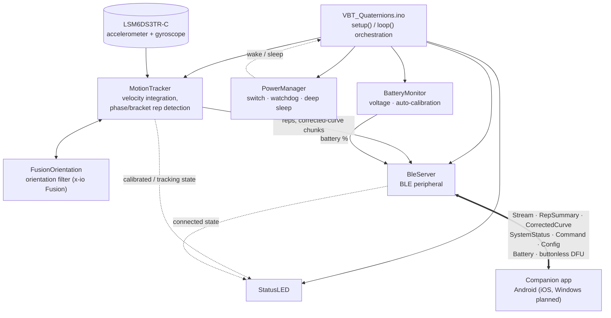
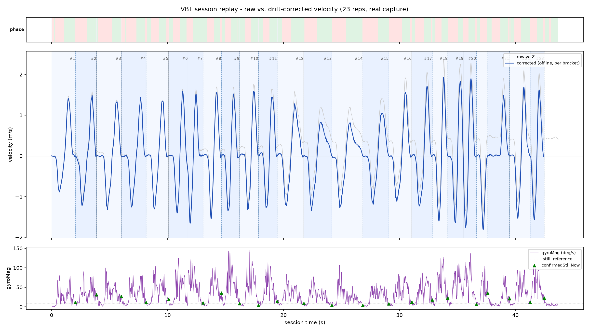
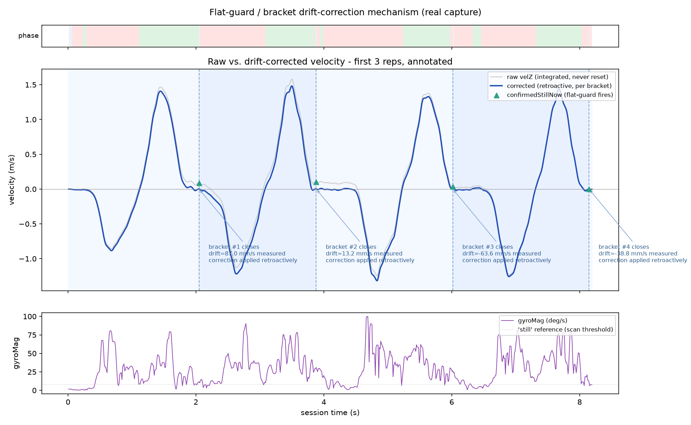

# ODKI VBT Firmware Documentation

**License note:** this document (and the figures in `img/`) is under the same license as the tracking engine it mainly describes — PolyForm Noncommercial 1.0.0 with ODKI's additional permissions, see [`LICENSE-ENGINE`](../LICENSE-ENGINE). That covers the text, not the ideas: explaining the algorithm here does not restrict anyone from implementing it themselves, and short quotations for study, criticism or review are free. The firmware outside the engine and the tools are open source under Apache-2.0, the BLE wire protocol is CC0 (see the [License section](BLE_PROTOCOL.md#license) of `BLE_PROTOCOL.md`); the map is in [`LICENSE`](../LICENSE).

This document describes the firmware that runs on the ODKI VBT sensor: a Seeed XIAO nRF52840 Sense (an nRF52840 microcontroller with an onboard LSM6DS3TR-C accelerometer/gyroscope), programmed with the Arduino framework. It is organized as one chapter per source file, in roughly the order a newcomer should read them: the entry point first, then the core rep-detection algorithm, then BLE, then the supporting hardware modules.

## What the device does

The sensor clips onto a barbell or is held during a lift. Once calibrated (held still for the CALIBRATE command) and started (the START command), it:

1. Fuses its accelerometer and gyroscope into a stable 3D orientation estimate.
2. Uses that orientation to isolate real (muscular) acceleration from gravity, and expresses it along a fixed vertical axis in the world, regardless of how the sensor is oriented on the bar.
3. Integrates that acceleration into velocity, continuously correcting for drift using brief moments of genuine stillness between reps.
4. Detects individual reps from the resulting velocity signal — including recovering multiple reps from a continuous set where the athlete never fully pauses between them — and reports peak/mean velocity, acceleration, displacement, and a data-quality score for each one.
5. Streams live telemetry and per-rep results to a companion app over Bluetooth Low Energy, and can log raw per-sample data over USB serial for offline analysis.

## Module map

| File | Responsibility |
|---|---|
| `VBT_Quaternions.ino` | Top-level orchestration: wires the modules together in `setup()`/`loop()`. |
| `Config.h` | Shared build-time constants (pins, firmware version, timing). |
| `MotionTracker.h` / `.cpp` | The core algorithm: IMU fusion, velocity integration, rep detection. |
| `BleServer.h` / `.cpp` | The Bluetooth peripheral: custom streaming/control service, wire protocol. |
| `FusionOrientation.h` / `.cpp`, `src/Fusion/` | The orientation filter (accelerometer + gyroscope sensor fusion): a thin wrapper around the x-io Technologies Fusion AHRS v1.3.3, vendored unmodified in `src/Fusion/` (MIT license). Since v3.12.0 the only filter — see [FusionOrientation](#fusionorientation). |
| `PowerManager.h` / `.cpp` | Power switch handling, hardware watchdog, deep sleep. |
| `BatteryMonitor.h` / `.cpp` | LiPo voltage reading, charge percentage, self-calibration. |
| `StatusLED.h` / `.cpp` | The onboard RGB status LED. |

The diagram below shows how these fit together at runtime — `VBT_Quaternions.ino` orchestrates every module from `setup()`/`loop()`; the only module that talks to the outside world is `BleServer`, over the custom BLE service described in its chapter.

## Required libraries

- **Seeed Arduino LSM6DS3** (Seeed Studio) — IMU driver.
- **Bluefruit52Lib** — ships with the `Seeeduino:nrf52` Arduino board package; no separate install needed.
- **Adafruit TinyUSB** — USB CDC serial, used for the debug log.
- **x-io Fusion** v1.3.3 — the orientation filter, vendored unmodified in `VBT_Quaternions/src/Fusion/` (MIT); nothing to install.

Board package: `Seeeduino:nrf52`, board `xiaonRF52840Sense`.

## Tooling

`tools/vbt_log_viewer.py` is a Python companion script for the raw debug log described in the [Lab data capture](#lab-data-capture-serial-log) section below. It parses a capture (opening a serial connection to the sensor is now enough to produce one, see that section — v3.11.24), offline-reconstructs the drift-corrected curve with the exact same formula the firmware uses, prints a per-rep recap and an anomaly scan to the console, and plots raw vs. corrected velocity — either as a static overview (`python vbt_log_viewer.py session.log --save overview.png`) or as an animated real-time playback (`--live`). `--acc` adds acceleration and jerk panels plus a shock-candidate scan to the static overview (the scan reads the unfiltered `worldAccZRaw` when the log has it — jerk above 1500 m/s³ or magnitude above 25 m/s² by default, `--jerk-thresh` to change — and the median-filtered `worldAccZ`, with weaker 600 m/s³ / 12 m/s² thresholds, on older logs; see [Mechanical shocks](#mechanical-shocks) for why a jerk threshold alone is not a shock detector), and running it with no arguments (or `--gui`) opens an interactive GUI — same dark look as `vbt_live_monitor.py` — where any log column (raw, corrected, accelerations, gyroscope, flags, phases, rep number…) can be ticked on or off, grouped into one stacked panel per unit, with overlays for the phase shading, bracket closes, rep numbers and shock candidates. It's what produced both images in the MotionTracker chapter, from a real capture. Requires `numpy`, `pandas`, and `matplotlib` (`pip install numpy pandas matplotlib`).

`tools/vbt_live_monitor.py` (v3.11.25+) is a Tkinter GUI that opens the same USB-serial connection *live* instead of replaying a saved file: a rolling chart of three velocity traces, each with its own checkbox — `velZLive` (the live corrected estimate the engine decides on), raw `velZ`, and the retroactively *corrected* curve (white), rebuilt from the `B,` rows with the same formula as `vbt_log_viewer.py` and drawn when each bracket closes, so it lags the live traces (unlike the viewer, it also shows the bracket-closing sample `t1`, at ~0) — with the flat-guard's ±0.20 m/s ceiling and every confirmed-stillness/discarded-phase event marked, acceleration, a big current-phase/rep readout, a table of completed reps as they're scored, and a console for every other line the firmware prints (battery, BLE messages, calibration warnings). Its Calibrate/Start/Stop buttons send the plain-text `CALIBRATE`/`START`/`STOP` serial commands added in v3.11.21/v3.11.22 (`pollSerialCommands()` in the .ino) — the whole tracking lifecycle can now be driven without the phone app, and since v3.11.24 the sensor starts printing its raw log the moment this tool's serial connection opens (see [Lab data capture](#lab-data-capture-serial-log)) — no app step needed for that either; only the runtime Config (rep direction, phase thresholds, …) is still BLE-only. The controls sit on three rows so the window fits a laptop screen: the connection row (serial port, Connect, firmware version, battery), then a two-row toolbar — device controls (`CALIBRATE`, `START`, Delay, `STOP`) on the first row, chart controls (the three trace checkboxes, time window, Pause, Clear, Record to file) on the second. The Delay selector next to START (no delay, or 5–30s in steps of 5) is a self-timer local to the tool — it holds off sending `START` for that long, counting down in the big phase readout, so whoever's about to lift has time to get under the bar; the firmware itself is unaware of it and still receives a plain immediate `START` once the count reaches zero. It can optionally record every raw line to a `.log` file as it streams, which `vbt_log_viewer.py` can then replay offline. The "drift" readout is `velZ − velZLive`; since v3.12.2 `velZ` is set to 0 while the sensor is confirmed still (see [Velocity integration](#velocity-integration--never-reset-during-motion)), so it shows the drift accumulated since the last stillness, not since `START`. Requires `pyserial`, `numpy`, and `matplotlib` (`pip install pyserial numpy matplotlib`) plus Tkinter (bundled with the python.org installers; `sudo apt install python3-tk` on Debian/Ubuntu).

**v3.11.25 — redraw throttling:** user-reported high CPU/heat during use, and stalls when the window was resized to fullscreen or a selector's list was opened. The matplotlib redraw — not the 100Hz serial read, which stays cheap — is the actual cost, and it used to run on a fixed ~20fps timer regardless of whether anything had changed, including while idle, disconnected, or paused. It's now skipped entirely when nothing new arrived since the last frame, and throttled to ~8fps while actively streaming (see the module docstring for the full explanation, including why this was also the root cause of the fullscreen/pop-up stalls — Tkinter is single-threaded, so a background timer doing expensive rendering was competing with the OS's own resize/popup handling on the same thread). `SampleBuffer` is also now capped to the largest selectable window (60s, was 10 minutes of history nothing ever displays), so the per-frame cost stays constant instead of slowly growing over a long session.

`tools/full_replay/` (v3.12.0; it grew out of the feasibility study that preceded the switch to Fusion) runs a captured log through the **whole** chain: `harness.cpp` drives the real `MotionTracker::update()` — sampling, both 5-sample medians, the Fusion orientation filter, gravity split, both bias estimators, phase/bracket engine, all compiled unchanged, like `host_replay/` — with a per-sample IMU input that `reconstruct.py` rebuilds from the log (see [Rebuilding the filter input from a log](#rebuilding-the-filter-input-from-a-log)). `python full_replay.py capture.log [--out DIR]` prints the replay's per-rep values next to the logged ones and writes the replayed log; a log with the 48-field `S,` row (firmware ≥ 3.12.0) carries all the state the replay needs, older ones need `--scale` (or a `CALIBRATE` line in the log) and start from the projected `accZBias` only, and were recorded with the Madgwick filter that Fusion replaced in 3.12.0 — so on those the replay shows what this firmware would have reported on the same motion, not a bit-exact reproduction. `python regression.py` is the regression test of the chain: it generates a deterministic **synthetic** recording (a tilted sensor, six squat-like reps with small rotations, noise and a gyroscope bias — made-up motion, not a measurement), replays it and compares every rep's final `R,` row with the golden file in `golden/` (`synthetic_<firmware>.json`, named after the firmware it was made with; pass = same reps and every value within its last printed digit; whether the output is also byte-identical is reported separately, since another compiler may round the last float digit differently). `--update` rewrites the golden file after an intended change; with the environment variable `ODKI_DUMP_CHUNKS` set, the harness also prints one `C,bracketId,chunkIndex,totalChunks,startTimestampMs,sampleCount,v0,v1,…` row per `CorrectedCurve` chunk (what the app receives; off by default, so the regression output does not change); `--real DIR` runs the same check on recorded logs whose golden outputs live outside the repository (logs are personal data — the maintainers keep theirs privately). Keep any `--out` folder outside the repository too. Requires `numpy`, `pandas` and `clang`/`clang++` (or `gcc`/`g++`).

`tools/calibration_seed/` holds the host test of the `CALIBRATE` seed (fixed in v3.12.0): `python run.py` builds `seed_test.cpp`, which checks that the seeded attitude reproduces the measured gravity direction within 1e-5 for tilts 0–180°, 24 azimuths and 3 magnitudes, and stays put for 3 s at rest — see [Calibration](#calibration).

The serial tools understand the v3.12.0 diagnostics: `vbt_live_monitor.py` asks `VERSION` on connect and shows the firmware version and orientation filter next to the port; `vbt_log_viewer.py` prints the `INFO,`/`TIMING,` lines of the analysed block (`parse_session_info()`) and lists the filter of each block.

`tools/host_replay/` (v3.11.29+) compiles the real `MotionTracker.cpp` on a PC (small stubs stand in for the Arduino, I2C and IMU headers) and replays the per-sample vertical acceleration of a captured log through it, printing the same `S,`/`R,`/`B,`/`P,` log the firmware prints — so a change of input (or of an engine default) can be evaluated offline with the production algorithm instead of a re-implementation. `python replay.py capture.log` (needs a log from firmware ≥ v3.11.28, i.e. with the `worldAccZRaw` column) compares integrating the median-filtered acceleration, the unfiltered one, the unfiltered one with the flat-guard still on the filtered signal (what the firmware does since v3.11.29), and a shock-window hybrid; with the old input it reproduces a v3.11.28 log to 0.0001 m/s. It accepts logs with the 37-, 41-, 44-, 48-, 53- or 54-field `S,` row. It injects the logged world-Z acceleration, so the orientation filter — and the shock window and landing detection, whose detector runs in `updateOrientationAndAcceleration()` — is not exercised; to replay a log from its raw IMU columns through `updateOrientationAndAcceleration()` as well, use `tools/full_replay/` above. `shock_experiments.py` drives the same engine with an experimental shock layer (detection, re-anchoring and interpolation implemented in Python with look-ahead — none of it exists in the firmware); see [Mechanical shocks](#mechanical-shocks) for what it showed. Requires `numpy`, `pandas`, `matplotlib` and a C++ compiler (`clang++`/`g++`).

---

## VBT_Quaternions.ino

The top-level sketch. Deliberately thin — its only job is wiring the other modules together in `setup()`/`loop()`; all the actual logic lives in the modules it calls into (`MotionTracker`, `BleServer`, `PowerManager`, `BatteryMonitor`, `StatusLED`).

**`setup()`**: brings up power management and the status LED first (so a very early failure is still visible), then the battery monitor, then logs the reset reason (useful for distinguishing a normal power-on from a watchdog-triggered recovery — see the PowerManager chapter), then starts BLE — which must happen before any possible call to deep sleep, since sleep entry depends on the BLE SoftDevice already being active — and finally the IMU. If the power switch isn't closed at boot, or the IMU fails to initialize, the device goes back to sleep or halts (blinking its status LED) rather than continuing in a half-working state.

**`loop()`** runs, in order:
1. Feeds the watchdog first, so anything that hangs further down in this same iteration (including a hang inside `goToSleep()` itself) still gets caught.
2. Checks the power switch; goes back to sleep if it's open.
3. Recomputes the status LED from current state.
4. Drains any pending BLE command (CALIBRATE / START / STOP) and any pending Config write, applying each to `MotionTracker`.
4b. Drains any pending **serial** command (v3.11.21/v3.11.22, `pollSerialCommands()`) — `START`/`STOP`/`CALIBRATE`, as plain newline-terminated text (case-insensitive), mirroring the same guarded calls used for the BLE versions of each. Added for `tools/vbt_live_monitor.py`, a desktop tool with no BLE access. `CALIBRATE` is exactly as blocking and pose-sensitive here as over BLE (~2s, device held still — see `MotionTracker::calibrateOrientation()`) — this only adds a second way to trigger it, not a gentler one. Runtime Config stays BLE-only deliberately — it already has a typed BLE packet (see `BleServer.h`) a text command would just duplicate. Reads `Serial.available()` one character at a time into a small fixed buffer rather than `Serial.readStringUntil()` — the latter blocks up to `Serial`'s timeout (1s by default) when a line arrives incomplete, which would stall the 100Hz sampling loop; this way an incomplete or malformed line just waits harmlessly in the buffer for its next character, or is dropped if the buffer's cap (24 bytes since v3.12.0, 16 before) is exceeded. **v3.12.0** added diagnostics that never touch the tracking algorithm: `VERSION` prints the identity line also printed at boot (`ODKI VBT firmware 3.12.0 filter=FUSION`); `TIMING` prints the current `TIMING,` line and `TIMING RESET` zeroes it (see [Lab data capture](#lab-data-capture-serial-log)); `FILTER` answers `FILTER=FUSION` — Fusion is the only orientation filter, so `FILTER` is read-only (kept so tools that send it still get an answer) and `FILTER <name>` is answered as an unknown command. The full list of serial commands is in [Serial commands](#serial-commands) below.
5. Reports battery status, gated to once every `Config::BATTERY_CHECK_INTERVAL_MS`, independent of tracking state.
6. Calls `MotionTracker::update()`, which self-limits to one sample every 10 ms or more (nominally 100Hz, about 95Hz in practice — see [Known limitations](#known-limitations)) and returns `true` only when it actually computed a new sample — everything below is gated on that, since `loop()` itself runs much faster than 100Hz and would otherwise repeat stale work between real updates.
7. If a new sample was computed and tracking is active: attempts to deliver one completed rep, then one queued corrected-curve chunk (see the MotionTracker and BleServer chapters for why both of these are peek/pop patterns rather than a single blocking send), then, decimated to 20Hz and only when the raw debug log isn't active, sends the live Stream packet.
## Config

The smallest file in the firmware: the build-time constants that don't belong to any single module.

- `WAKE_PIN` (`D6`) — the power switch input pin, shared between `PowerManager` (reading it) and the pin-mode setup that happens there.
- `FirmwareVersion::{MAJOR, MINOR, PATCH}` — the firmware version, exposed over BLE via the standard Device Information Service (see the BleServer chapter) so the companion app can compare it against the latest available release and offer an OTA update without any manual step from the user. Also printed at boot, by the `VERSION` serial command and in the `INFO,` line at every `REC_START`. Increment on every release — see [Versioning and releases](#versioning-and-releases).
- `Config::BATTERY_CHECK_INTERVAL_MS` (30000) — how often the main loop re-reads and reports battery status, independent of whether tracking is active.
- `Config::STREAM_DECIMATION_FACTOR` (5) — the internal IMU/motion-tracking loop runs at 100Hz, but the BLE Stream characteristic sends only 1 sample in every N, to avoid saturating the connection: 100Hz / 5 = 20Hz over the air.

## MotionTracker

This is the core of the firmware: it reads the IMU, fuses it into a stable orientation, integrates that into a vertical velocity, and turns that velocity signal into discrete, measured reps. Everything else in the firmware (BLE streaming, the live LED, the debug log) is a consumer of what this module produces.

The rep-detection engine was rebuilt from scratch in v3.11.0 (replacing an earlier zero-velocity-update/ZUPT design used through v3.10.x) after real-hardware testing kept surfacing the same structural problem: any scheme that periodically forces the integrated velocity back to exactly zero has to decide, sample by sample, whether "the sensor looks quiet" really means "the sensor is at rest" — and during a slow rep, or right at a rep's own peak (where acceleration crosses zero by definition), those two things can look identical for a moment. The current design sidesteps the problem instead of patching around it: **no decision ever depends on the integrated velocity being reset**. Between two confirmed stillnesses it is always the true, raw integral of acceleration, so nothing the engine computes from it can "jump" (since v3.12.2 `velZ` is set to 0 while the sensor is *confirmed* still, but everything measured against it moves by the same amount, so no difference changes — see [Velocity integration](#velocity-integration--never-reset-during-motion)). Genuine stillness is still detected — it's what makes the whole system work — but instead of being used to *reset* the signal, it's used to *measure how far the signal has drifted* since the last time the sensor was still, and that measured drift is then subtracted back out **retroactively**, across the whole interval it accumulated over. Two independent scan tools exist to see this in practice — a live per-sample debug log (see [Lab data capture](#lab-data-capture-serial-log) below) and the `tools/vbt_log_viewer.py` companion script, which replays a captured log exactly as the algorithm saw it and produces the plots referenced throughout this chapter.

### Pipeline overview

Every sample (100Hz, gated inside `update()`) goes through:

1. **`updateOrientationAndAcceleration()`** — reads the IMU, runs the orientation filter ([FusionOrientation](#fusionorientation)) to get an orientation quaternion (held, without updating the filter, while a shock window is open — v3.12.6 test build, see [Mechanical shocks](#mechanical-shocks)), and uses that orientation to split the raw accelerometer reading into gravity and *linear* acceleration, expressed in a fixed world frame instead of the sensor's own (rotating) frame. Also drives the two continuous bias estimates (below).
2. **`stepPhaseEngine()`** (called from `integrateMotion()`) — integrates world-frame vertical acceleration into a velocity that is never reset during motion (since v3.12.2 it is set to 0 while confirmed still, a change of reference that leaves every difference unchanged), decides moment to moment whether a rep **phase** (a concentric or eccentric half-rep) should open or close, and separately decides whether the sensor is genuinely still right now. Every sample of a movement is also appended to a rolling **bracket** buffer (while the sensor stays still, the buffer keeps only the latest still sample — v3.12.1, see [Bracket drift correction](#bracket-drift-correction)).
3. **Bracket close** — whenever a genuine stillness event begins, the bracket that has been accumulating since the *previous* stillness event closes: the drift it picked up is measured directly (raw velocity vs. the last known-good reference) and distributed back across every sample in that bracket, retroactively. Any phase that closed while inside that bracket gets rescored on the now-corrected curve and re-reported.
4. Two small FIFO queues — completed reps and corrected-curve chunks — hold results until `VBT_Quaternions.ino` successfully delivers each one over BLE, one at a time.

The image below shows the whole mechanism on a real capture (23 reps, 43.7s, `tools/vbt_log_viewer.py test_log.txt`): the grey line is the raw integral (a log recorded before v3.12.2, when `velZ` was never zeroed — on newer logs it returns to 0 in every pause); the blue line is what the corrected curve looks like once every bracket in the session has closed. Notice the raw curve visibly creeping upward as a baseline offset over the course of the set — pure integration drift — while the corrected curve keeps returning cleanly to zero between reps.

### Sensor reading and orientation

The LSM6DS3 IMU samples internally at 416Hz, but processing runs at a nominal 100Hz (about 95Hz in practice, see [Known limitations](#known-limitations)). `FastSampleAccumulator::poll()` is called on every `loop()` iteration (much faster than 100Hz) and accumulates every genuinely new IMU sample by checking the status register directly; `harvest()` averages whatever arrived since the last processed sample. This means no IMU sample is silently dropped between two 10ms ticks — they're all averaged in, which is a basic anti-aliasing measure.

Both the accelerometer and gyroscope readings (already the 10ms means above) pass through a 5-sample median filter (`MedianFilter3`) before the orientation filter and the flat-guard touch them. A median filter (not a moving average) rejects an *isolated* outlier sample (an occasional I2C/BLE-radio glitch, a one-sample spike) almost entirely, while barely affecting a real, sustained acceleration that spans several consecutive samples the way muscular effort does. It costs (N-1)/2 samples of latency (20ms at N=5).

**Since v3.11.29 the vertical velocity bypasses the median:** `velZ` is integrated from the *pre-median* world-Z acceleration (the log's `worldAccZRaw`). The reason is the same property that makes the median useful elsewhere: on a real deadlift capture the floor impact is a 20-30ms spike of 31-43 m/s² — the very impulse that stops the bar — and the median erased it (the filtered signal peaks at 7-16 m/s² in the same windows), so with the median in the integration path `velZ` stayed at −0.5…−1.5 m/s with the bar at rest and the bracket correction then spread that step over the rep; integrating the unfiltered signal returned it to within ±0.05 m/s after every landing. On a bipolar knock the median also keeps one lobe and drops the other, leaving a net step the raw integral cancels by itself. The median-filtered signal is still what feeds the orientation filter, the flat-guard's acceleration test and the reported peak/mean acceleration (so those are not made noisier). See [Mechanical shocks](#mechanical-shocks) for the measurements, and `tools/host_replay/` to compare both inputs through the real engine.

The gyroscope, converted to rad/s after bias subtraction, and the filtered accelerometer feed the [Fusion AHRS](#fusionorientation) with the loop's real `dt`. Fusion corrects the gyroscope-integrated attitude towards the accelerometer's "down" in proportion to the tilt error (`gain` 0.5), ignores the accelerometer entirely for any update where its direction is more than 10° from the estimated gravity — i.e. during real motion, when it is no longer a trustworthy reference — and forces it back in if it has been mostly ignored for 5 s, so orientation never relies purely on the gyroscope (which would drift unboundedly) for an extended stretch. Fusion replaced, in v3.12.0, the Madgwick filter with an adaptive gain used up to v3.11.31; see the FusionOrientation chapter.

The resulting quaternion is used to:
- Subtract gravity from the raw accelerometer reading, in the sensor's own frame, yielding `linAcc*` — genuine linear (muscular) acceleration.
- Rotate `linAcc*` into the world frame (`worldAcc*`), where "vertical" is a fixed axis regardless of how the sensor is oriented on the barbell/limb.

### Continuous bias estimation

Two slow-moving biases are estimated continuously, both gated on the *same* "is the sensor truly still right now" condition (low gyroscope magnitude AND accelerometer magnitude **flat** over a short sliding window), sustained for `RuntimeConfig::accZBiasIdleStillTimeS` (accelerometer bias) or `gyroBiasIdleStillTimeS` (gyroscope bias), both 0.3 s since v3.12.3:

- **`accZBias`** (now `accBiasVec`, see the v3.11.13 note below) — even a well-calibrated orientation leaves a small residual offset on the world-frame vertical acceleration (alignment error, slow orientation drift during motion). Without correcting for it, integrated velocity would never return to exactly zero at rest. Estimated with a ~2s time constant, frozen during real motion. Tuned via `RuntimeConfig::accZBiasGyroMaxDegS`/`accZBiasAccMagToleranceMps2` (the "quiet enough to trust" thresholds).
- **Gyroscope bias** — the zero-rate offset seeded once during `calibrateOrientation()` can shift during a session (typically thermal drift as the chip warms up). Left uncorrected, a stale bias slowly rotates the estimated "up" direction, which is the most likely cause of a slow `accZBias` drift on long sessions. Uses a much slower ~8s time constant (`RuntimeConfig::gyroBiasIdleStillTimeS` gates when it engages), since the goal here is tracking thermal drift, not reacting quickly.

This is the same raw, IMU-only stillness signal (gyroscope magnitude + the accelerometer-magnitude flatness window, nothing derived from the velocity estimate itself) that also backs the flat-guard override described below — it is deliberately kept independent of any velocity-based judgment of "quiet."

**v3.11.11 fix — why "flat" instead of "close to `G`":** earlier versions gated the accelerometer half of this condition on `|accMag − G| < accZBiasAccMagToleranceMps2` — an *absolute* comparison against gravity. That's only reliable if the accelerometer's magnitude scale (`accelScaleG`, fit once, isotropically, in `calibrateOrientation()`) corrects the sensor perfectly at *every* orientation, which a single scalar generally can't do on a real MEMS part with any per-axis sensitivity mismatch. At a resting orientation different from the one used at calibration time, `accMag` could read stably outside tolerance while the device was genuinely still (gyroscope confirmed near-zero), permanently blocking both bias updates and leaving `accZBias` frozen at a value inherited from a previous session/orientation — diagnosed on a real capture that was pure rotation with no translation at all, where this froze `accZBias` for 8.8s and drove `velZ` to the safety clamp. The gate now checks that `accMag` is *flat* (low excursion) over a short window instead, which is orientation-independent by construction and needs no protocol change (it reuses `accZBiasAccMagToleranceMps2` as the excursion half-band rather than an absolute-difference tolerance).

**v3.11.13 fix — a vector, not a scalar:** even after the fix above, real hardware logs showed the residual itself isn't constant — it depends on the device's *current* orientation (0.33 m/s² near the calibration orientation, 0.15 m/s² at a moderate tilt, on the same capture), because a single isotropic accelerometer scale factor can't fully correct a real MEMS part's per-axis sensitivity mismatch at every attitude. `accZBias` was replaced with `accBiasVec`, a fixed vector in the sensor's own body frame, projected onto the *current* gravity direction (`gravBodyX/Y/Z`, already computed every sample from the orientation quaternion) to get the correction to apply right now — it adapts as the device's orientation changes, including during motion, not just at the one orientation it happened to be resting at when the estimate last updated. The update rule is the same single-observation LMS step as before, just applied to a 3-vector instead of a scalar (it reduces to the exact old scalar EMA in the special case where gravity's direction in the body frame never changes). This corrects the *symptom* in the velocity domain using the existing single-position `calibrateOrientation()` — it does not fix the anisotropy in the orientation estimate itself, which would need a proper multi-position, per-axis accelerometer calibration.

**v3.12.3 fix — the accelerometer bias also learned during motion:** with `accZBiasIdleStillTimeS` at 0.05 s (5 samples, the default up to v3.12.2) the gate also opened *during* motion, whenever the bar moved with near-constant acceleration and little rotation: the gyroscope was quiet and `|acceleration|` was flat, so `accBiasVec` learned and absorbed real acceleration. On a recorded deadlift set `worldAccZ` then read −0.2 to −0.4 m/s² in the pauses, the drift reached −1.5 m/s in one bracket, one rep of 10 was lost (its concentric was too short on `velZLive` and was discarded) and stillness was confirmed late. With 0.3 s (the same as `gyroBiasIdleStillTimeS`): 10/10 reps, drift per bracket within about ±0.07 m/s, stillness confirmed in 0.09 s in every pause, rep-cycle calibration active. On 5 recorded squat sets the drift is lower too and rep values shift by a few percent; one set previously counted as 4 reps now gives 10 (the true count was not recorded — not verified). Since v3.12.4 the field is firmware-only (see the [`RuntimeConfig` field reference](#runtimeconfig-field-reference)).

**v3.11.14 fix — from a cumulative counter to a sliding window:** the "quiet enough to trust" signal itself used to be a single cumulative duration counter (`accZBiasStillDuration`) that reset **completely** to zero on the very first violation — one isolated noisy sample (a rack or floor vibration, a hand not perfectly still) threw away all the time already accumulated, forcing a full wait from scratch. This made both bias updates *and* the flat-guard override (below) far slower and more unpredictable than they needed to be in a normal, slightly noisy environment. It's now the same sliding-window logic already used elsewhere in this engine (`excursionFlat`/`absoluteFlat`, generalized to take the ring's capacity as an explicit parameter): raw gyroscope magnitude and accelerometer magnitude are kept on two rolling history buffers, and each of the timers that depend on this signal (`accZBiasIdleStillTimeS`, `gyroBiasIdleStillTimeS`, and — until v3.11.27 replaced it, see [below](#the-flat-guards-two-tier-design) — `flatGuardOverrideStillTimeS`) just checks a different window length over the *same* two buffers. An isolated bad sample now costs at most one window's worth of delay — it ages out on its own — never a full reset.

### Velocity integration — never reset during motion

`velZ` is the authoritative signed vertical velocity: positive is up, negative is down, always, independent of which direction is configured as the "concentric" one (`RuntimeConfig::repDirection`, applied once via a `+1/-1` sign multiplier immediately after integration — every other part of the engine works on the already-oriented value). It is integrated trapezoidally every sample from the pre-median world-Z acceleration (`worldAccZRaw` in the log, see [Sensor reading and orientation](#sensor-reading-and-orientation); the median-filtered `worldAccZ` before v3.11.29) and — this is the structural change from the old design — during motion it is **never touched again**: not zeroed, and (since v3.11.19) not clamped either. Whatever bias remains after the continuous `accZBias` correction above accumulates in `velZ`; correcting for that accumulated drift is the entire job of the bracket mechanism below, not of the integration step itself. `±RuntimeConfig::maxPlausibleVelocityMps` is still a hard sanity ceiling, but it applies to `velZLive` (the corrected estimate computed a few lines later, see [Rep phases](#rep-phases-opening-and-closing) below) — clamping `velZ` itself, as earlier versions did, meant a long or touch-and-go set that legitimately drifted past 4&nbsp;m/s (drift, never real bar speed) fed a *clipped* raw sample into the bracket's drift measurement and the corrected-curve math, silently corrupting both for as long as the clamp was active.

**v3.12.2 — `velZ` is set to 0 during confirmed stillness.** Up to v3.12.1 `velZ` was the raw integral since the session start and drifted freely; only the anchor `baselineRawVel` followed it during a pause (see [Live re-anchoring](#live-re-anchoring-for-display)). Now, on every confirmed-still sample except one where a bracket closed, `shiftVelocityFrame()` shifts the velocity frame by `c = velZ`: `velZ`, `prevVelZ`, `baselineRawVel` and every buffered `bracketBuf[].velZ` move by −c, the rep-calibration sums and intercept move by the matching amount (`SumY −= n·c`, `SumTY −= c·SumT`, intercept −= c, so a refit gives the same rate and an intercept lower by exactly c), and `lastCrossingRawPos` gains `c·(t − lastCrossingT)` so the displacement since the last crossing is unchanged. Every difference the engine uses is therefore unchanged — the drift `velZ − baseline`, the corrected curve, `refVelZ`, `velZLive`, `livePosZ`, the flat-guard rings — and on the recorded sets replayed through `tools/full_replay/` reps, values and corrected curve are identical to v3.12.1 (to the last printed digit). This is not a return to the ZUPT design: no stillness decision is taken on a reset value, and the reset does not change what the engine measures. The tests on the *sign* of the velocity itself (the zero-crossing in `checkZeroCrossing()`, the backfill in `openPhase()`) keep reading the velocity integrated since the session start, `velZ + velZFrameOffset` (`velZFrameOffset` is the sum of all shifts): moving them to the new frame changed rep detection on the recorded sets, so it is not part of this change. The shift is skipped on the sample where a bracket closes, so that the bracket's `B,` row and the `S,` row of that sample stay in the same frame and `vbt_log_viewer.py` can rebuild the corrected curve; the next confirmed-still sample does it. Visible effect, in the serial log only: `velZ` reads exactly 0 while still (except on the bracket-closing sample), and `repCalibIntercept` and the `B,` row's `baseline` (now usually 0) change accordingly. No change to the BLE packets or to the log format.

### Mechanical shocks

A mechanical shock — typically the bar landing on the floor in a deadlift — is a few-millisecond acceleration spike followed by 50-100ms of ringing. Two different problems hide under it, and the measurements below come from real captures replayed through the production engine (`tools/host_replay/`):

**1. The landing impulse was being erased (fixed in v3.11.29).** In a deadlift capture with the bar landing four times (plus a softer fifth), the unfiltered `worldAccZRaw` shows a 20-30ms spike of 31-43 m/s² at each of the four landings while the median-filtered `worldAccZ` peaks at only 7-16 m/s² in the same windows. That spike is the impulse that stops the bar, so with the median in the integration path the velocity never came back to zero: with the bar at rest `velZ` read −0.50, −0.70, −1.19, −1.52 m/s (cumulative over the four landings). The impulse missing from the filtered integral (∫raw − ∫median across each landing) was +0.59, +0.33, +0.62, +0.37 m/s, against residual velocity errors of −0.48, −0.20, −0.49, −0.34 m/s — the error plus the missing impulse is within +0.03…+0.13 m/s. Integrating the unfiltered signal (v3.11.29) leaves +0.02…+0.04 m/s at rest after every landing, and the bracket correction no longer has a large step to spread linearly over the whole rep (which had also inflated the concentric peak before the landing). Replayed offline through the same engine, squat captures also report reps the median input missed (5 vs 4, 10 vs 8, 10 vs 8 in three of five sets, the other two equal; never fewer) — the cause of that was not diagnosed. On a squat set the unfiltered integral does **not** drift less (on one set the mean correction subtracted is 0.39 m/s unfiltered against 0.24 m/s median-filtered, both ending near −0.85 m/s at rest): the gain is about impulses, not general drift.

**2. Telling a shock from normal motion.** The jerk of the unfiltered acceleration (`|d worldAccZRaw/dt|`) is much clearer than on the filtered signal (landings: 877-2839 m/s³; the filtered signal shows 378-1494 and misses two of the four main landings at a 600 m/s³ threshold) — but a jerk threshold alone is **not** a shock detector: in five squat sets it also fires once per rep (47 events, 620-3629 m/s³, up to 36 m/s², bar nearly still) at the bottom reversal, which is ordinary motion. What separates them in these captures is the raw gyroscope: the five landings have a burst of 135-510 deg/s, the two shocks at the unracking of one set 298-359 deg/s, the other 45 squat events 19-105 deg/s — so jerk above 600 m/s³ **and** a raw gyroscope burst above ~120 deg/s flagged every landing and both unracking shocks and none of the reversals. The margin is thin for the softest landing (135 against a squat maximum of 105 deg/s) and the sample is small.

**What was tried and did not help** (offline, real engine, detection implemented in Python with look-ahead — none of it is in the firmware; the causal detector of point 3 below is a different design): closing the bracket at a shock that is followed by stillness and re-anchoring the velocity to zero (on the deadlift capture it created a spurious 0.01m rep and moved rep displacements by 0.08-0.13m, without a reference to say which was right); interpolating the acceleration across shocks in the middle of motion (with a jerk-only detector it dropped or added reps; behind the gyroscope gate it never triggered); and keeping brackets or rep cycles that contain a shock out of the EMA and the rep-cycle regression (it produced rep displacements of 1.07 and 0.73m in the first reps of one squat set). A jerk filter on the integration input (holding the previous value) was also tried and removed in v3.11.9-v3.11.10: it made drift worse on a capture of continuous, alternating shaking, because holding through one spike of a closely-spaced opposing pair swallows the cancellation plain integration provides.

**3. Landing impulse and orientation hold (v3.12.6, test build — not released).** A later deadlift set with the bar put down on the floor ten times showed two further failures, which add up (3.12.4 counted 4 of the 10 reps, with a drift of −12.8 m/s in one bracket):

- *The measured landing impulse had the wrong sign.* At a landing the bar arrives at −0.3…−0.5 m/s and the floor should give it about +0.5 m/s, but the unfiltered samples read −43, −40, −22… m/s² (the raw accelerometer at −3.4 g) while the gyroscope alternated ±100–430 deg/s from one sample to the next: vibration of bar and plates that the 10 ms mean of the 416 Hz readings aliases instead of representing. Each landing integrated −1.2…−2.0 m/s and `velZ` stayed near −1.8 m/s with the bar at rest. Integrating the unfiltered signal (point 1) cannot fix this: the input itself is wrong.
- *The same vibration corrupted the orientation.* The spurious gyroscope burst rotates the quaternion: the tilt error against gravity, at rest, went from 0.5° to 3–8° after the first landings, then 12°, 23° and 43°. Above 10° Fusion rejects the accelerometer (`accelerationRejectionDeg`, see [Settings](#settings-fusionorientationsettings)) and runs on the gyroscope alone, so the error no longer recovers (accelerometer ignored 94–100 % of the time between two landings, until the 5 s forced recovery). With 23° of error `worldAccZ` reads −0.7 m/s² at rest (−2.5 at 43°), integrated continuously: stillness was no longer confirmed, brackets lasted 5–9 s and the linear correction spread −3…−13 m/s over several reps.

The fix is causal (at most 6 samples, 60 ms, of delay) and has two parts, all thresholds in `RuntimeConfig` (`shock…` fields, firmware-only, see [the field reference](#runtimeconfig-field-reference)):

1. **Detector** (`shockDetectorStep()`, in `updateOrientationAndAcceleration()` *before* the orientation filter, on every sample): the jerk of the unfiltered accelerometer projected on the *previous* sample's gravity direction minus `accelScaleG` (the current attitude is not known yet at that point). A **shock window** opens when the jerk exceeds `shockJerkOpenMps3` (800 m/s³) and closes after `shockQuietSamples` (3) consecutive samples below `shockJerkQuietMps3` (300 m/s³), once it is longer than `shockQualifySamples` (6), or after `shockMaxWindowSamples` (40) at most. While the window is open — the opening sample included — Fusion is **not updated** and the quaternion stays at its pre-shock value. The gravity split, the bias estimators and the integration keep running on the held attitude. Detector and landing state (point 2) are reset at every `START`/`STOP` and after `CALIBRATE` re-seeds the orientation, so no window is carried over.
2. **Landing** (`shockEngineStep()`, in `stepPhaseEngine()` *before* the integration): when a sample's jerk exceeds `shockJerkOpenMps3` and no candidate or landing is in progress (the sample that opens a window, or a later one in the same window after a candidate was released), a **candidate** opens and stores `vPre = velZ − livePredictedOffset()` (the live velocity just before this sample is integrated — what `velZLive` would read, unclamped); its samples, the opening one included, are held out of the integral. It becomes a **landing** as soon as all three hold, counted over the candidate's samples on the integration input (the unfiltered `worldAccZRaw`, directed and clamped to ±100 m/s²): one sample with \|acceleration\| above `shockLandingPeakAccMps2` (25 m/s²); `shockLandingSustainSamples` (2) samples above `shockLandingSustainAccMps2` (20 m/s²) *or* a raw gyroscope magnitude (`gyroRaw*`, the 10 ms mean before median and bias) of at least `shockLandingGyroDegS` (100 deg/s) on one of them; and `vPre` below `shockLandingMinDescentMps` (−0.05 m/s, the bar was going down). Then `velZ −= vPre` — the floor stops the bar, the measured impulse is replaced by the physically known one — the held samples are dropped, and 0 is integrated until the shock window closes. Otherwise the candidate is **released**: the held increment is added back unchanged (a rectangle sum) after `shockQualifySamples` samples, or as soon as the window has closed with at least 2 samples held. Together with the half-trapezoid steps at both edges of the hold, this equals the trapezoidal integral of the same samples (exactly for a constant sample period), so a released candidate only delays the velocity (by at most 60 ms) and does not change it.

The difference from the substitutions tried before (median, zero, interpolation of the shock samples) is that those dropped the true impulse and kept the arrival velocity in the integral; here the arrival velocity itself is cancelled, so the result is right both when the shock is measured well and when it is not.

Replayed through `tools/full_replay/` (Fusion and engine, from the logged raw IMU columns), on that deadlift set: 10 of 10 reps, largest drift per bracket 0.13 m/s, displacement 0.53–0.59 m and peak velocity 1.27–1.51 m/s on reps 2–10, estimated contact velocity −0.29…−0.52 m/s at the ten landings (an eleventh, −0.10 m/s, about 0.13 s after the third one). Rep 1 reads 0.42 m up against 0.75 m down — it has no landing before it to anchor it; *not verified*. Holding only the orientation gives 4 reps (drift 3.7 m/s), only the landing impulse 10 reps (drift 3.0 m/s, the last reps spoiled by the orientation): both parts are needed. On the other 21 recorded logs with the unfiltered columns: identical reps and values on six squat sets, four deadlift sets and one capture; the same reps with values within ±0.01–0.02 on seven others (the orientation hold at isolated jerk peaks without a landing); a simulated-deadlift capture with hard landings, where the raw integral was already right, the same 5 reps within −0.03…+0.02 m/s (largest drift 0.05 → 0.10 m/s); a squat set with a real knock at the start (gyroscope 359 deg/s) 9 → 10 reps, and a shock-test capture 2 → 4 reps (drift 1.30 → 0.57 m/s, 3 of its 6 landings recognised; the other 3 have a gyroscope below 100 deg/s and a single strong sample) — the true counts of those two were not recorded (*not verified*). No false landing on the squat sets: the isolated jerk peaks at the bottom of a squat (one sample, gyroscope below 80 deg/s) are released. The result is stable (always 10 reps on the deadlift set) for jerk thresholds of 500–1500 m/s³, peak 15–35 m/s², gyroscope 60–200 deg/s and windows of 20–60 samples. `shockHandlingEnabled = false` reproduces the engine without this layer exactly (checked on the same logs). The serial log marks every sample in the `shock` column of the `S,` row (see [Lab data capture](#lab-data-capture-serial-log)). `tools/host_replay/` injects the logged world-Z acceleration and bypasses `updateOrientationAndAcceleration()`, so the layer is not exercised there.

**Open risks** (need dedicated recordings on hardware): very fast touch-and-go deadlifts (if the bar leaves again within 0.2–0.3 s the window may cut the start of the pull), soft floors or platforms whose shocks stay below the thresholds, and the softer landings of the shock test that are not recognised.

**Still open:** the logs have no ground-truth velocity, so how much of the residual drift of a squat set comes from bias/orientation error rather than shocks, and whether a step-aware correction would beat the linear spread of the bracket mechanism, is not established.

### Rep phases: opening and closing

A **phase** is one concentric or eccentric half-rep — the same concept the very first (pre-ZUPT) version of this firmware used, now evaluated on a corrected estimate rather than the raw one (see the next section for why that distinction matters). A phase opens when the current best-estimate velocity crosses `RuntimeConfig::phaseStartVelocityMps` in either direction, and closes for one of three reasons:

- **Flat** — the flat-guard (below) confirms the sensor has gone still. This is what ends a normal rep.
- **Reversal** — the velocity has been moving the opposite way for `RuntimeConfig::reversalConfirmSamples` consecutive samples: the athlete changed direction without a real pause (e.g. bottom of a squat with no dead stop).
- **Timeout** — the phase has been open longer than `RuntimeConfig::maxPhaseDurationS`, a safety net against a phase that never resolves.

Two reps form a pair: an eccentric phase followed by the concentric phase that completes it. `RepResult` is only reported once the concentric side is known (see [Correction status](#correction-status-and-re-reporting) below); the eccentric side, if present, is folded in alongside it.

**v3.11.18 fix — rep numbering assumed phases always alternate direction:** the rep counter (`currentRepNumberEngine`) used to advance only when a phase closed in the *opposite* direction from the last one that closed (tracked via a `lastPhaseType` variable) — an assumption that a real capture broke: one concentric phase closed and was immediately followed by another concentric phase in the same direction, with no real reversal in between (visible in the raw log as one smooth, uninterrupted ascent silently cut into two "reps" by the engine — almost certainly a spurious flat/reversal false-trigger, not a genuine direction change). Once that happens, the alternation assumption never recovers: every eccentric phase reported afterward gets attributed to the *previous* rep's slot instead of its own, permanently, for the rest of the session — confirmed in the diagnosed capture from that point through its end. Fixed by making the counter advance unconditionally whenever a **concentric** phase closes, regardless of what closed before it — a rep is complete once its concentric phase closes, by definition, independent of anything else. `lastPhaseType` is gone entirely. A future spurious same-direction split now produces one orphaned rep (recognizable by a zero eccentric side) instead of corrupting every rep reported afterward.

### Flat-guard: deciding "the sensor is still"

This is the single most important judgment call in the whole engine, because it drives *everything* downstream: phase closing, bracket closing, and the continuous bias re-anchoring in the next section. It combines two independent tests, both evaluated over a **dynamically sized recent window** (`computeDynamicWindowSamples()`: the window shrinks from `maxVelocityFlatWindowSamples`/`maxAccelerationFlatWindowSamples` down to the `min…` values as the phase's own peak velocity rises toward `windowSaturationPeakVelocityMps` — a fast rep needs to confirm stillness quickly, a slow one can afford to wait longer to be sure):

- **Velocity excursion flat** — the recent window of velocity has a total spread (max − min) of at most 2 × `RuntimeConfig::velocityFlatBandMps`.
- **Acceleration flat** — every sample in the recent acceleration window is within `RuntimeConfig::accelerationFlatBandMps2` of zero.

While a phase is open, which window these two tests read is itself two-tiered (v3.11.27, see [below](#the-flat-guards-two-tier-design)): under the absolute ceiling `RuntimeConfig::flatGuardMaxVelocityMps`, both use the dynamic window described above; once the corrected velocity exceeds it, both switch to a fixed, wider window (`RuntimeConfig::velocityOverrideFlatWindowSamples`) instead.

Both conditions are evaluated on a **corrected, live estimate of velocity** (`velZ` minus the current best prediction of how much it has drifted — see `livePredictedOffset()`), *not* on the raw integral. This is deliberate, and it is the fix that made the whole retroactive-correction design actually work in practice: on a long or heavy set, the raw integral can drift past the flat-guard's velocity ceiling entirely, and if the ceiling were evaluated on the raw value, the flat-guard would simply never fire again for the rest of the session — no more brackets would close, and drift correction would silently stop (this failure mode was diagnosed on a real capture: one flat-guard close in 24 seconds). Evaluating against the corrected estimate instead means the ceiling check keeps working even while the raw integral drifts arbitrarily far, because it's the *drift-corrected* number being checked against it, not the raw one.

**v3.11.16 fix — the window-sizing peak had the same raw-vs-corrected problem:** `computeDynamicWindowSamples()` needs to know the phase's peak velocity to decide how far to shrink the window, and that peak was tracked from the raw `velZ` sample rather than the corrected estimate — the same class of bug fixed twice in v3.11.8 for the direction test elsewhere in the engine (raw `velZ` never resets, so once accumulated drift is large relative to a phase's real amplitude, its magnitude no longer reflects the actual motion). Concretely: after enough raw drift has built up over a long session, a genuinely *slow* rep could read an inflated peak from the drifted baseline alone, pick the short windows meant for a fast rep, and confirm "flat" with less real stillness than it should. Not traced to a specific hardware report — found by re-examining the v3.11.8 fix, whose own note had explicitly left this exact usage alone at the time ("no evidence it's broken"). Fixed by tracking the peak from the same corrected estimate already used for the direction test right next to it.

**v3.11.17 fix — idle reset the window to the SLOWEST setting, not the fastest:** the dynamic window above only makes sense while a phase is open, sized against *that* phase's own peak velocity. While idle (no phase open, between a close and the next open) there is no such context — yet `closePhaseFn()` reset `phaseVelWindowSamples`/`phaseAccWindowSamples` to the **max** window (`maxVelocityFlatWindowSamples`/`maxAccelerationFlatWindowSamples`, 300ms by default at the time, 200ms since v3.11.30) on every close, including a close caused by flatness itself, i.e. right after the engine had just proven stillness with a much smaller window (down to 2 samples for a fast rep). Since the absolute-ceiling half of the flat-guard is bypassed while idle (see the bullet list above — "while a phase is open" only), the re-anchor that zeroes the live reading depended solely on the excursion test over this now-oversized window, which still contained the tail of the deceleration into that very stillness — so it kept failing, and the live reading stayed away from zero, for up to ~300ms after a real, complete stop. Worse: if raw drift crossed `phaseStartVelocityMps` during that gap (it defaults to the same 0.2 m/s as `flatGuardMaxVelocityMps`), a spurious phase could reopen and reset the window to max again, compounding the delay until the old raw-stillness override (1.0s, meant as a rare last resort - since replaced, see [below](#the-flat-guards-two-tier-design)) stepped in to unstick it — user-reported as the live velocity sticking around ~0.20 m/s for close to a second after every stop. Fixed by resetting to the **min** window instead (`minVelocityFlatWindowSamples`/`minAccelerationFlatWindowSamples`, mirrored in `resetTracking()` at session start): idle has no peak-velocity context to size against, and the goal there is only to reconfirm stillness as fast as possible. A genuine stop now re-anchors within about one sample interval (10ms) instead of up to ~300ms, and the old override is no longer needed for the normal case.

The picture below zooms into the first four brackets of a real capture and annotates each close: the raw curve (grey) keeps a small residual offset after every rep, and the moment the flat-guard confirms stillness (green triangle, `confirmedStillNow`), the bracket closes and the corrected curve (blue) snaps back down to that segment's true zero.

### Bracket drift correction

A **bracket** is the stretch of samples from the last still sample before a movement to the next confirmed stillness event. Every sample from there on is appended to a bracket buffer regardless of whether a phase is open (`bracketBuf`, capacity 3000 samples / 30s — a safety cap, not a design target). While the sensor stays still, the reference (`baselineRawVel`, `bracketStartT`) follows the current sample (see the v3.11.2 note in `MotionTracker.cpp`) and, since v3.12.1, the buffer is cut back to that one sample whenever no phase is open or waiting to be rescored: the pause itself never belongs to a bracket, so its corrected value is never sent and the app keeps the live value it already shows (0). When the flat-guard condition transitions from false to true (a *rising edge* — not every sample while it stays true, or a long real pause would re-close the bracket on every single sample), `closeBracketFn()` runs:

1. **Measure the drift.** `drift = velZ − baselineRawVel`, where `baselineRawVel` is the raw `velZ` value the *previous* bracket close (or the last still sample) left behind — not absolute zero, by construction; since v3.12.2 it is usually 0 because `velZ` itself is set to 0 while still, see [Velocity integration](#velocity-integration--never-reset-during-motion). This is what makes the corrected curve continuous across bracket boundaries instead of showing a small "step" at every rep.
2. **Distribute it retroactively and linearly.** Every sample `s` in the closing bracket is corrected as `corrected(t) = velZ(t) − baseline − drift × (t − t0) / (t1 − t0)` — the same formula the app receives via the `CorrectedCurve` BLE characteristic, and the one `tools/vbt_log_viewer.py` uses to reconstruct the plots in this chapter offline from a raw debug log.
   Here `t0` is the bracket's start (the last still sample before the movement, where the corrected value is exactly 0) and `t1` the closing sample, so the linear ramp is interpolated inside the bracket instead of being extrapolated over the pause before it. **v3.12.1 fix — pauses were changed by the correction:** up to 3.12.0 the still samples of a pause stayed in the buffer *before* `t0`, and the formula above extrapolated the bracket's drift ramp backwards over them: the `CorrectedCurve` turned a pause that the live curve had shown as 0 into a non-zero velocity, by `(t0 − t)/(t1 − t0)` times the bracket's drift (reported by the user; on five recorded squat sets up to 0.68 m/s, after a 1.2 s pause followed by 0.2 s of motion). The fix does not change how phases are scored; it can change a rep only through the phase-start look-back (`phaseLookbackSamples`, default 5), which up to 3.12.0 could extend a phase back into still samples before `t0` and now stops at `t0`. Replayed through `tools/full_replay/`, those five sets give output identical line for line (every `S,`/`R,`/`B,`/`P,` row) with 3.12.0 and 3.12.1, while the corrected value of every still sample sent in a `CorrectedCurve` chunk went from up to 0.68 m/s to exactly 0. Side effect: a long pause no longer fills `bracketBuf` (before, 30 s of stillness forced a close through the capacity cap). `tools/vbt_log_viewer.py` always reconstructed the curve only over `[t0, t1]`, so its plots already showed the corrected behaviour.
3. **Rescore every phase the bracket contained.** Any phase that closed while this bracket was still open was originally reported using a *provisional* estimate (below); it is now rescored against the true measured drift and re-reported with `correctionStatus = Corrected`.
4. **Move the reference forward.** `baselineRawVel` becomes the current `velZ` — the next bracket measures its own drift relative to *this* point, not to zero.

Because the correction for a bracket is only known once it closes — which can be a second or more after the samples inside it were captured — a phase that closes *before* its own bracket does can't wait for the true number. It's scored immediately with a **provisional** estimate instead: an EMA of recently-measured bracket rates (`RuntimeConfig::emaAlpha` — how much a single new measurement moves the running average) extrapolated forward in time, or the rep-based calibration below if that's already available and considered more reliable. It's this same EMA rate, evaluated live every sample as `livePredictedOffset()`, that the flat-guard tests against in the previous section.

**v3.11.26 fix — a noisy short bracket could seed a rate later extrapolated unbounded over a much longer one:** user-reported from a real capture (a heavy/slow deadlift rep) — `velZLive` started diverging from `velZ` about 5 seconds in and kept getting worse, reaching nearly double the raw value before snapping back once the rep reversed. Two compounding causes, both in the EMA path above (the rep-based calibration below was unaffected — `repCalibCount` hadn't reached 2 yet in the diagnosed window). First, `closeBracketFn()` moved `emaRate` by the *same* `emaAlpha` regardless of how long the closing bracket had actually run — a 150ms bracket (noise between two close reps, 15 samples) swung the estimate just as hard as a full 1-2s one, in the diagnosed capture seeding a rate of 0.206 m/s² from that noise alone. Second, `livePredictedOffset()` extrapolated that rate *linearly and without limit* over the elapsed time since the last anchor — fine for a normal rep under a second, but the very next bracket then stayed open 8.95s (a slow eccentric with no still pause to re-anchor it), during which the 0.206 rate compounded to a predicted offset of 0.90 m/s, entirely an artifact of the seed bracket's noise. Fixed with two independent, narrowly-targeted changes, both simulated against the real capture before being implemented (drift-window max error 1.61 → 0.30 m/s, RMS 0.87 → 0.27 m/s; the 145 samples where `velZLive` exceeded 1.0 m/s while `velZ` itself stayed under 0.35 m/s — reported velocity with no corresponding real motion — dropped to zero): `closeBracketFn()` now scales `emaAlpha` down for brackets shorter than 1.0s, so a short noisy bracket can no longer move the EMA nearly as much as a full-length one; `livePredictedOffset()` caps the extrapolated elapsed time at 2.5s, past which the offset freezes at its best estimate instead of continuing to run away — normal re-anchoring still corrects it the instant a real reference point (a genuine pause, or the next bracket close) becomes available.

### Rep-based calibration (bracket-independent)

Bracket correction requires a genuine pause — it has nothing to measure otherwise. A separate, complementary calibration source needs no pause at all: every negative-to-positive zero-crossing of raw velocity (one full descend-then-rise cycle) should, physically, return to very nearly the same position it started from, regardless of how fast or slow that particular rep was. Each valid crossing (`RuntimeConfig::minCrossingExcursionMps`/`minCrossingDurationS` filter out noise) contributes one data point — mean time, net position offset over that cycle — to an incrementally-updated linear regression (`repCalibRate`, `repCalibIntercept`). Once at least two such cycles are available, this calibration is used *in preference to* the EMA bracket rate for provisional scoring, because it keeps improving through a continuous, gapless set (e.g. touch-and-go reps with no true stillness anywhere) where brackets may close rarely or not at all.

### The flat-guard's two-tier design

Even with the live-corrected-estimate fix above, one failure mode remained: during a long stretch with no bracket ever closing, the provisional estimate itself (EMA or rep calibration) can accumulate enough error that the corrected `velZLive` value it produces stays outside `flatGuardMaxVelocityMps` *even while the sensor is genuinely motionless* — not because the sensor is drifting, but because the estimate being used to judge it is wrong, and without a bracket closing, that estimate has no way to correct itself. It's the same underlying failure shape as the raw-vs-corrected fix earlier in this chapter, just moved up one level of indirection.

**v3.11.27 fix — the raw-stillness override almost never fired, and dropping the ceiling wasn't safe either:** through v3.11.26, the safety net for this (`flatGuardOverrideStillTimeS`, 1.0s) watched raw gyroscope/accelerometer stillness instead of `velZLive` — independent of the estimate, but requiring a full, *unbroken* second with every sample in the window under band. User-reported still unresolved on a second real deadlift capture (`STACCO_3`) even after v3.11.26 bounded the drift: the bar's ground contact (unavoidable in a deadlift) is a real, expected deceleration, and `velZ` settled genuinely flat within under a second of it — but the override never fired even once in the whole capture, because post-impact ringdown scatters small noise samples through that window, each one forcing the full second to restart from scratch. A simpler alternative — dropping `flatGuardMaxVelocityMps` from the primary path entirely and trusting the dynamic-window flatness tests alone — was considered and rejected after simulating it against the same capture: at high phase-peak velocity the dynamic window shrinks to as little as 2 samples (20ms), and a smooth velocity curve's acceleration crosses zero at *every* local peak by simple calculus, for a few milliseconds instead of hundreds — with a 2-sample window that momentary crossing at the *top* of a fast rep is indistinguishable from a genuine stop. Confirmed directly in the capture's own first rep: without the ceiling, the engine would have declared "flat" at `t=1.423s` with `velZLive=1.0065 m/s` — the exact peak of a clean 1.27 m/s pull, not a stop. So the ceiling stays on the fast/dynamic-window path (it's load-bearing there), and the override is replaced instead: once a phase is open and `|velZLive|` exceeds `flatGuardMaxVelocityMps`, **both** flatness tests switch from the dynamic window to `RuntimeConfig::velocityOverrideFlatWindowSamples` — a fixed window (30–60 samples, configurable from the app) over the *same* `velZLive`/`worldAccZ` signal the fast path already uses, not raw IMU noise, so an isolated post-impact sample doesn't force a full restart the way the old raw-quiet ring did. Long enough that a genuine pause (flat for hundreds of ms) can't be mistaken for a fast rep's momentary peak (tens of ms), short enough to resolve well inside a second. Verified against both captures before implementing: the wide window correctly does *not* fire at the `STACCO_3` rep-1 peak (actual excursion over the window: 1.01 m/s, nowhere near the 0.08 m/s band it needs), and fires early into the problem stretch that used to run for 8-10 seconds unbounded. Every time it fires it's still flagged in the debug log (`flatGuardOverrideFired`, same field, repurposed) so it can be audited after the fact; `tools/vbt_log_viewer.py` marks these with a red triangle on the overview plot and reports a count in its console summary.

### Live re-anchoring for display

While the flat-guard confirms the sensor still (`confirmedStillNow`), `baselineRawVel` (and the bracket's start time) are kept continuously aligned to `velZ` for the *entire* duration of the pause, not just at the moment the bracket closes. This has two effects from the same mechanism: the value streamed live for the app's real-time graph (`refVelZ = velZ − baselineRawVel`) reads a clean ~0 throughout a real pause instead of sitting on a not-yet-converged residual, and the *next* phase's provisional correction starts from a fresh reference instead of a stale one left over from before the pause began. The re-anchoring itself never changes `velZ` or the values of the buffered bracket samples — only the reference they are measured against (since v3.12.2 the frame shift that follows it sets `velZ`, the anchor and the buffered samples to the same new frame, which changes no difference; since v3.12.1 the still samples buffered before that reference are also dropped, see [Bracket drift correction](#bracket-drift-correction)).

**v3.11.15 fix — the rep-based calibration needed the same treatment:** the re-anchoring above only ever applied to `baselineRawVel`/`bracketStartT`, which feed the EMA estimate. The rep-based calibration from the previous section has no equivalent — `repCalibRate × sessionT + repCalibIntercept` is a fixed regression over *absolute* session time, and until this fix nothing ever refreshed it between rep cycles. Traced to a real capture where a bracket stayed open for 10.77 seconds spanning three reps, unstuck only by a deliberate manual jolt: because `repCalibCount ≥ 2` after just two valid cycles — true for nearly all of a real set — this calibration, not the EMA, is what `livePredictedOffset()` actually uses almost the entire time, and its estimate kept drifting away from the truth on its own during the stall, since `sessionT` keeps advancing while `repCalibIntercept` stood still. The fix mirrors the EMA re-anchoring exactly, just applied to the regression's intercept: while the sensor is confirmed still, `repCalibIntercept` is recomputed so the formula evaluates to exactly `velZ` at that instant. It leaves the regression's accumulated sums untouched, so the next real rep cycle still refits it properly from scratch — this only keeps the *live* reading correct during the pause in between.

**v3.11.20 fix — a refit itself could jump the live reading, no pause involved:** v3.11.15 fixed the estimate going *stale* during a long stall; it didn't cover the estimate changing *abruptly* at the moment `checkZeroCrossing()` registers a new cycle and calls `refitRepCalibration()` — which happens roughly once per rep once `repCalibCount ≥ 2` is the active estimate, i.e. for most of any real set. Traced to a real capture where the rep counter stalled for 13+ seconds despite continuous movement: `repCalibRate × sessionT + repCalibIntercept` is re-evaluated with the newly-refit coefficients at the *current*, already-large `sessionT` — so even a change in `repCalibRate` too small to matter near the regression's own data (thousandths of a unit) gets multiplied by `sessionT` and can dominate the result, an ordinary consequence of evaluating a freshly-refit line far from the window it was fit against. Confirmed sample-by-sample on 5 consecutive refits in the capture: `velZLive` dropped by 0.17–0.25 m/s in a single ~10ms sample *every time*, always right as the concentric phase was ramping up (raw `velZ` rising smoothly in that same sample) — an artificial dip exactly where the phase engine is most sensitive to direction and magnitude, plausibly behind the cluster of concentric phases that closed just under `minPhaseDurationS` and got silently discarded. Fix: the same continuity principle as v3.11.15, applied at a different trigger — right after `refitRepCalibration()` runs inside `checkZeroCrossing()`, `repCalibIntercept` is nudged so the formula evaluates to exactly what it was an instant before, at the same `sessionT`. Neither `repCalibRate` nor the accumulated sums are touched, so the fit's long-term accuracy (and the next refit's starting point) is unaffected — only the artificial step at the instant of *this* refit is removed from the live reading.

### Correction status and re-reporting

Every reported rep (`RepResult`) carries a `correctionStatus`, and the **same rep can be sent more than once** with the same `repNumber` as its estimate improves — the receiving app is expected to overwrite by `repNumber`, not append:

| Status | Meaning |
|---|---|
| `Provisional` (0) | Scored against the EMA-extrapolated bracket rate; its own bracket hasn't closed yet. |
| `RepCalibrated` (1) | Scored against the rep-based crossing calibration (≥2 valid cycles available), used when no bracket has closed recently. |
| `Corrected` (2) | Scored against a bracket's *measured* drift — the bracket containing this phase has closed. Final; won't be re-reported again. |

A rep's overall status is the *worse* (least certain) of its concentric and eccentric phase statuses.

### Calibration

`calibrateOrientation()` is a blocking ~2 second routine (`CALIBRATION_SAMPLES` samples at `CALIBRATION_SAMPLE_DELAY_MS` apart) that must be run with the device genuinely at rest. It:
- Averages accelerometer readings and hands them to the orientation filter's `alignToGravity()`, giving the filter a correct starting orientation instead of assuming the device begins level: the seeded attitude's gravity direction (`gravBody`) equals the measured one, with zero yaw. Before v3.12.0 that starting orientation had the tilt mirrored — off by twice the tilt — and the filter then had to recover from it on its own while the sensor stayed still (with the Madgwick filter used before 3.12.0: 2.6 s at 15° of tilt, 8.6 s at 45°, about 17 s at the ~72° of the analysed squat logs, never at 90°); a set started within that time integrated a wrong vertical. Fixed in v3.12.0, see [The `CALIBRATE` seed](#the-calibrate-seed): a set can now start right after `CALIBRATE`. Not yet verified on hardware.
- Averages gyroscope readings to seed the gyro bias (the zero-rate offset at rest).
- Derives this specific accelerometer's real g→m/s² scale factor (`accelScaleG`): at true rest the acceleration vector's magnitude must equal exactly `G`; any deviation is a factory scale/offset error on that particular sensor, not real motion, so the correction factor is computed once and used everywhere gravity is subtracted afterward. Clamped to a ±15% sanity window — outside that range a calibration or movement error during the window is assumed and the ideal `G` is used unmodified instead.
- Rejects individual outlier samples during the averaging window (occasional readings a full order of magnitude above the normal at-rest noise floor have been observed on real hardware, most likely transient I2C/radio contention rather than physical movement) and warns over Serial if the gyroscope range during the whole window suggests the device wasn't actually still.

### Delivering reps and corrected-curve chunks without blocking

Two small FIFO queues sit between this module and BLE, following the same peek/pop pattern for both:

- **Reps** (`pendingReps`, capacity 32) — `peekCompletedRep()` copies the oldest queued rep without removing it; `popCompletedRep()` removes it. `VBT_Quaternions.ino` calls `popCompletedRep()` only *after* `BleServer::sendRepSummary()` actually succeeds (see the BleServer chapter for why this two-step pattern exists) — if delivery fails, the rep just stays at the front of the queue and is retried on the next sample.
- **Corrected-curve chunks** (`chunkQueue`, capacity 220) — a bracket close can produce thousands of corrected samples at once (`enqueueCorrectedCurveChunks()`), far more than fit in one BLE packet, so they're split into fixed-size chunks (`CorrectedCurveChunk::CAPACITY = 20` samples each) and drained the same peek/pop way as reps.

Neither queue ever silently drops data because of a busy or momentarily disconnected link — only the (deliberately generous) fixed queue capacity is a hard limit, and it's sized well above anything observed in real captures.

### `RuntimeConfig` field reference

All fields except the shock-handling group (below) are carried by the BLE Config characteristic (see the BleServer chapter), and none are persisted to flash — the firmware always boots from the compiled defaults (`RuntimeConfig{}`, i.e. the values below). `setConfig()` clamps the window fields on the way in, because they index the fixed 64-sample `FLAT_RING_CAPACITY` rings: every `max…WindowSamples` and `velocityOverrideFlatWindowSamples` is capped at 64, `velocityOverrideFlatWindowSamples` is raised to at least 30, and each `min…WindowSamples` is kept between 1 and its `max…` counterpart. No other field is range-checked.

**Firmware-only fields (v3.12.4).** Seven fields — `accZBiasIdleStillTimeS`, `gyroBiasIdleStillTimeS`, `accZBiasGyroMaxDegS`, `accZBiasAccMagToleranceMps2`, `emaAlpha`, `minCrossingExcursionMps`, `minCrossingDurationS`, marked *(firmware-only)* below — are not adjustable at runtime: the Config packet keeps their place (same 38-byte layout, so every app version keeps working), but a value written over BLE is ignored, the compiled default always applies, and the Config Read echo shows it (`lockFirmwareOnlyFields()` in `BleServer.cpp`). The reason: apps up to 1.0.5 re-sent the stored values of these fields, which their UI does not expose, on every connection — after v3.12.3 moved `accZBiasIdleStillTimeS` from 0.05 to 0.3 s they would have pushed the old 0.05 back. All other fields of the packet stay adjustable.

**Shock-handling fields (v3.12.6, test build).** The `shock…` fields at the end of the table are firmware-only in a stronger sense: they are not in the Config packet at all (its 38-byte layout is unchanged). `packetToConfig()` starts from `RuntimeConfig{}`, so a Config write always leaves them at their compiled defaults. See [Mechanical shocks](#mechanical-shocks), point 3.

| Field | Default | Meaning |
|---|---|---|
| `repDirection` | `Up` | Which physical direction counts as the concentric (measured) phase. |
| `maxPlausibleVelocityMps` | 4.0 | Hard clamp on `velZLive`, both directions (v3.11.19; was `velZ` itself through v3.11.18 — see the version note in `MotionTracker.cpp`) — beyond this it's certainly drift, not real motion. |
| `accZBiasIdleStillTimeS` | 0.3 | *(firmware-only)* Consecutive stillness time required before refreshing `accZBias` (0.05 up to v3.12.2, see the [v3.12.3 fix](#continuous-bias-estimation)). |
| `gyroBiasIdleStillTimeS` | 0.3 | *(firmware-only)* Consecutive stillness time required before refreshing the gyroscope bias. |
| `accZBiasGyroMaxDegS` | 12.0 | *(firmware-only)* Gyroscope-magnitude ceiling (deg/s) below which a sample is a candidate for bias updates. |
| `accZBiasAccMagToleranceMps2` | 0.12 | *(firmware-only)* Half-width of the excursion band `\|acceleration\|` must stay within, over a short sliding window, for a sample to be a bias-update candidate (v3.11.11+; was an absolute distance from `G` before). |
| `flatGuardMaxVelocityMps` | 0.20 | Corrected live velocity above which — while a phase is open — the flat-guard judges stillness over the fixed `velocityOverrideFlatWindowSamples` window instead of the dynamic one (v3.11.27; before that it was an absolute ceiling the flat-guard could never fire above). |
| `velocityOverrideFlatWindowSamples` | 30 | (45 before v3.11.30) Fixed flatness window (samples) used once `\|velZLive\|` exceeds `flatGuardMaxVelocityMps` — replaces the dynamic window for BOTH flatness tests above in that case (v3.11.27, see [The flat-guard's two-tier design](#the-flat-guards-two-tier-design)). The app offers 30–60; the firmware clamps any written value to 30–64 (see below). |
| `velocityFlatBandMps` | 0.04 | Half-width of the velocity flat band: the recent velocity window counts as flat if its spread (max − min) is at most twice this. |
| `maxVelocityFlatWindowSamples` / `minVelocityFlatWindowSamples` | 20 / 2 | Dynamic window bounds (samples, 10ms each) for the velocity flatness test; 30 / 2 before v3.11.30. |
| `accelerationFlatBandMps2` | 0.3 | Every sample of the recent (median-filtered) acceleration window must be within this of zero to count as flat. |
| `maxAccelerationFlatWindowSamples` / `minAccelerationFlatWindowSamples` | 20 / 2 | Dynamic window bounds (samples, 10ms each) for the acceleration flatness test; 30 / 2 before v3.11.30. |
| `windowSaturationPeakVelocityMps` | 0.8 | Peak velocity above which both windows above saturate to their minimum size. |
| `phaseStartVelocityMps` | 0.2 | Corrected-velocity threshold for opening a new phase. |
| `minPhaseDurationS` | 0.35 | Minimum phase duration; shorter ones are discarded as noise. |
| `maxPhaseDurationS` | 5.0 | Timeout after which an open phase is force-closed. |
| `phaseLookbackSamples` | 5 | How many already-buffered samples a newly opened phase backfills, so its start isn't clipped to the exact threshold crossing. |
| `reversalConfirmSamples` | 3 | Consecutive opposite-direction samples required to confirm a reversal close. |
| `emaAlpha` | 0.3 | *(firmware-only)* Ceiling weight of a single newly-closed bracket's rate on the running EMA drift-rate estimate — scaled down for brackets under 1.0s long (v3.11.26, see the version note below), so a short noisy bracket moves the estimate less than a full-length one. |
| `minCrossingExcursionMps` | -0.03 | *(firmware-only)* Minimum (negative) excursion required for a zero-crossing to count toward rep-based calibration. |
| `minCrossingDurationS` | 0.3 | *(firmware-only)* Minimum cycle duration to count toward rep-based calibration. |
| `shockHandlingEnabled` | true | *(not in the packet)* Shock window, orientation hold and landing impulse on/off; `false` is exactly the engine without them. |
| `shockJerkOpenMps3` | 800 | *(not in the packet)* Jerk of the unfiltered world-Z acceleration (on the previous sample's gravity) that opens a shock window and a landing candidate. |
| `shockJerkQuietMps3` / `shockQuietSamples` | 300 / 3 | *(not in the packet)* The window closes after this many consecutive samples with jerk below this value (once longer than `shockQualifySamples`). |
| `shockMaxWindowSamples` | 40 | *(not in the packet)* Longest shock window (samples); the orientation is held while it is open. |
| `shockQualifySamples` | 6 | *(not in the packet)* Samples a landing candidate is held for before it is released unchanged. |
| `shockLandingPeakAccMps2` | 25 | *(not in the packet)* A landing needs one sample of the candidate above this \|acceleration\|. |
| `shockLandingSustainAccMps2` / `shockLandingSustainSamples` | 20 / 2 | *(not in the packet)* …and this many samples above this \|acceleration\|, or a raw gyroscope of at least `shockLandingGyroDegS`. |
| `shockLandingGyroDegS` | 100 | *(not in the packet)* Raw gyroscope magnitude (deg/s) that substitutes for the sustained-acceleration test. |
| `shockLandingMinDescentMps` | -0.05 | *(not in the packet)* …and the live velocity at the opening must be below this (bar moving down, in the `repDirection` frame). |

**In the companion app** (v1.0.1+): the settings screen shows the rep direction, the stillness-detection group (`flatGuardMaxVelocityMps` … `windowSaturationPeakVelocityMps`) and the phase-detection group (`maxPlausibleVelocityMps` … `reversalConfirmSamples`), each with a one-line explanation; the three drift-correction fields (`emaAlpha`, `minCrossingExcursionMps`, `minCrossingDurationS`) and the bias fields (`accZBiasIdleStillTimeS`, `gyroBiasIdleStillTimeS`, `accZBiasGyroMaxDegS`, `accZBiasAccMagToleranceMps2`) are not shown. Up to app 1.0.5 these seven were still stored and re-sent by the app; since firmware v3.12.4 the sensor ignores them (see above), and from app 1.0.6 the app no longer stores them and sends back the values the sensor reports. The app's defaults are kept equal to this table.

**v3.11.24 — `debugLogEnabled` removed:** it used to be a field in this table (a BLE-only, RAM-only switch for the raw serial log below), but that made it a recurring source of confusion — it reset to off on every power cycle just like calibration, and there was no way to turn it on at all from a serial-only tool (`tools/vbt_live_monitor.py`) with no BLE access, since it's the phone app that would have to set it. It's now decided automatically: see [Lab data capture](#lab-data-capture-serial-log) below.

### Lab data capture (serial log)

The firmware prints this log automatically whenever a USB-serial connection is open (v3.11.24 — `serialLogActive()` in `MotionTracker.cpp`, `(bool)Serial` under the hood, the same check `deviceConnected()` uses for the status LED; before this version it was gated on the now-removed `debugLogEnabled` Config field instead). Bracketed by `REC_START`/`REC_STOP` markers with each row type's CSV header printed once at the start of a recording:

- **`S,` rows** — one per sample at the internal rate (nominally 100Hz) (`logSampleCsv()`): raw sensor/orientation data, `velZ` (raw integral; never reset up to v3.12.1, since v3.12.2 exactly 0 on every confirmed-still sample except the one that closes a bracket — see [Velocity integration](#velocity-integration--never-reset-during-motion)), `refVelZ` (live re-anchored display value), `velZLive` (the corrected estimate the engine actually makes decisions on), the current rep-calibration rate/intercept/count (since v3.12.2 the intercept is expressed in the same shifted frame as `velZ`, so its value differs from earlier logs while the prediction `velZ − velZLive` does not), and the four per-sample event flags (`velClamped`, `bracketClosed`, `confirmedStillNow`, `flatGuardOverrideFired`). Since v3.11.28 the row ends with four more columns tapped *before* the 5-sample median (log-only in v3.11.28; since v3.11.29 `worldAccZRaw` is also the acceleration integrated into `velZ`): `worldAccZRaw` (same world-Z projection and bias as `worldAccZ`, on the unfiltered accelerometer, unclamped) and `gyroRawX`/`gyroRawY`/`gyroRawZ` (the 10ms-mean gyroscope in deg/s, before the median and before bias subtraction) — added to study shock detection on the least-filtered signal available (the only stage upstream is the 10ms mean of the 416Hz IMU samples). Since v3.11.32 (log-only, no change to tracking or BLE) three more columns follow them: `accRawX`/`accRawY`/`accRawZ`, the body-frame accelerometer in m/s² (the 10ms mean times `accelScaleG`) *before* the 5-sample median — exactly what enters `accMedianFilter`, just as `gyroRawX/Y/Z` is what enters `gyroMedianFilter`. With both, the log carries every value `updateOrientationAndAcceleration()` reads from the IMU, so an offline replay can cover the orientation filter too. **Since v3.12.0:** four more columns at the very end — `accelScaleG` (the accelerometer scale `CALIBRATE` fitted) and `accBiasX`/`accBiasY`/`accBiasZ` (the body-frame `accBiasVec`, of which `accZBias` is only the projection on gravity). These are the state of `updateOrientationAndAcceleration()` that cannot be rebuilt from the other columns; with them, the 48-field row lets an offline replay (`tools/full_replay/`) re-run the orientation filter from the first sample of a log (the remaining unlogged state — the two 5-sample median histories and the bias-gate rings — only affects the first few samples). Logged on every row rather than once at `REC_START` so that a log cut anywhere still carries them. **Test builds** append further columns, always at the end: the 3.12.5 diagnostic build five 416 Hz saturation taps (`accPeakG` — largest raw accelerometer reading of the 10 ms window on any axis, in g; `accClipCount` — readings at full scale; `accSampleCount` — readings averaged; `gyroPeakDegS`, `gyroClipCount` — the same for the gyroscope), 53 fields; the v3.12.6 test build one more, `shock` (54 fields): `0` no shock, `1` shock window or landing candidate open and not (yet) a landing (orientation held while the window is open, acceleration held while a candidate is open), `2` landing window (0 integrated), `3` the sample on which the landing impulse was applied (`velZ −= vPre` there, so `velZLive` on that row reads about 0 — exactly 0 unless the landing is confirmed on the candidate's first sample, which still integrates half of the previous sample's trapezoid step). Always `0` with `shockHandlingEnabled = false`. Older 37-, 41-, 44-, 48- and 53-field rows are still accepted by `vbt_log_viewer.py`, `vbt_live_monitor.py`, `host_replay` and `full_replay` (the missing columns read as NaN).
- **`INFO,` line** (v3.12.0+) — printed once after the headers at every `REC_START`: `INFO,firmware=3.12.0,filter=FUSION,calibrated=1,accelScaleG=9.49012`. Identifies the firmware that wrote the log and its orientation filter, and repeats the accelerometer scale `CALIBRATE` fitted. (`vbt_log_viewer.py` reads the line as key=value pairs, so a line with extra or missing fields still parses.)
- **`TIMING,` line** (v3.12.0+) — printed just before `REC_STOP` (and on demand by the `TIMING` serial command): `TIMING,filter=FUSION,samples=N,filterMeanUs=…,filterMaxUs=…,sampleMeanUs=…,sampleMaxUs=…,dtMaxMs=…,dtOver11ms=…`. `filter*` is the `micros()` cost of the orientation-filter update, `sample*` that of a whole 100Hz sample (orientation, engine and, while logging, printing the `S,` row), `dtMaxMs`/`dtOver11ms` the longest loop period and how many periods exceeded 11 ms (with the current sampler some 12 ms periods are normal, see [Known limitations](#known-limitations)). Accumulated since `REC_START` (or the last `TIMING RESET`). A few integer additions per sample, no effect on tracking. It is how a hardware test verifies that Fusion runs in real time (not yet measured on hardware: a static estimate from the compiled code is below 10 µs per update, against a 10 ms sample period).
- **`R,` rows** — one per completed rep (re-printed as its correction status improves, per [Correction status](#correction-status-and-re-reporting) — the last one for a given `rep` is authoritative).
- **`B,` rows** — one per bracket close (`bracketId, t0, t1, baseline, drift, rate, emaRateAfter, basisTotal`). `baseline` is in the same frame as the `S,` rows of that bracket; since v3.12.2 it is usually 0 (see [Velocity integration](#velocity-integration--never-reset-during-motion)), and `drift` is unchanged. Together with the `S,` rows in `[t0, t1]`, this is everything needed to reconstruct the corrected curve offline with the exact formula from the [bracket drift correction](#bracket-drift-correction) section above — this is what `tools/vbt_log_viewer.py` does to produce both images in this chapter.
- **`P,` rows** (v3.11.18) — one per phase close *attempt* (`phaseId, repNumber, phaseType, closeReason, durationS, sampleCount, discarded, reported`, plus `t_start_ms, t_end_ms` since v3.11.32), including ones silently discarded for being too short (`reported=0`) — those never produced an `R,` row before this, so there was no way to see them at all. `closeReason` is `0`=flat, `1`=reversal, `2`=timeout. Two consecutive `P,` rows with the same-sign `phaseType` and no rep-completing close between them is the signature of a spurious same-direction split (see the v3.11.18 fix note in `MotionTracker.cpp` for the bug this caused before it was fixed) — this row makes that directly visible instead of requiring it to be reconstructed from the `S,` rows' `state` column, which can't distinguish "closed and immediately reopened the same direction" from "never actually closed". `t_start_ms`/`t_end_ms` (v3.11.32, log-only) are the device `millis()` — the same clock as the `S,` rows' `t_ms` — of the phase's first sample and of its last *kept* sample (the end of the span `durationS` measures, before the discarded tail), so a phase can be matched to an external reference (e.g. a linear encoder) directly, without reconstructing it from the `state` column. They are rebuilt exactly at close time by walking back through the bracket buffer's per-sample `dt` (an integer number of ms each), so they need no extra RAM; when nothing of the phase is kept (`cutoff < 0`) `t_end_ms` equals `t_start_ms`. `vbt_log_viewer.py`'s `parse_p_rows()` returns these rows as a table (NaN in the two columns on older logs).

**Bandwidth.** At 100Hz the `S,` row is the only one that matters: about 270 bytes per row up to v3.11.31 (measured on real v3.11.28+ captures, at most ~285), about 295 bytes with the v3.11.32 columns (estimated, up to ~315 during violent motion) — roughly 30 KB/s; the four `accelScaleG`/`accBias` columns (v3.12.0+) add about 33 bytes (estimated, ~330 bytes/row, ~33 KB/s); the test-build columns about 20 more (saturation taps) and 2 (`shock`). USB CDC on the nRF52840 is a native full-speed USB link (12 Mbit/s bus; the `115200` passed to `Serial.begin()` is ignored), so the margin should be large, but the throughput has not been measured on this board. A row that could not be sent in time would show up as a `dt_ms` above the normal 10–12 ms in the log, which is the check to run after changing the row.

This is meant for a laptop actively reading the serial port during a capture session — leaving the sensor plugged into a USB charger with nothing reading the port has the same real CPU/power cost every cycle as an intentional capture, and writing to a serial buffer that nobody is draining can, on some platforms, stall the loop and delay sampling itself; unplug it (or close the serial connection) for normal untethered training. The decimated BLE stream (this app's live graph, see `StreamPacket` in the BleServer chapter) is automatically disabled while a serial connection is open, since it would otherwise duplicate the same data at a lower rate over a separate channel competing for the same `loop()` cycle — the two are mutually exclusive by construction, not by a setting either side has to remember to flip.

### Serial commands

Plain newline-terminated text on the USB-serial port, case-insensitive (`pollSerialCommands()` / `handleSerialCommandLine()` in the .ino, at most 23 characters per line). What `tools/vbt_live_monitor.py` sends; any serial terminal works too.

| Command | Since | Effect |
|---|---|---|
| `START` | v3.11.21 | Starts tracking (ignored until calibrated) — same guarded call as BLE `0x01`. |
| `STOP` | v3.11.21 | Stops tracking — same as BLE `0x00`. |
| `CALIBRATE` | v3.11.22 | Runs [Calibration](#calibration) (~2 s, device held still; ignored while tracking) — same as BLE `0x02`. |
| `VERSION` | v3.12.0 | Prints `ODKI VBT firmware 3.12.0 filter=FUSION` (also printed at boot). |
| `FILTER` | v3.12.0 | Prints `FILTER=FUSION`. Read-only: Fusion is the only orientation filter, and `FILTER <name>` is answered as an unknown command. |
| `TIMING` / `TIMING RESET` | v3.12.0 | Prints the current `TIMING,` line / zeroes its counters. |

Anything else is answered with `Unknown serial command: <line>`. Runtime Config is deliberately BLE-only.

## BleServer

Implements the device's Bluetooth Low Energy peripheral role: one custom service for streaming and control, plus the standard Battery and Device Information services, plus buttonless DFU for over-the-air firmware updates. This is the only file that talks to the Bluefruit52Lib / SoftDevice BLE stack directly — the rest of the firmware only calls the functions declared in `BleServer.h`.

### Custom service characteristics

| Characteristic | Properties | Purpose |
|---|---|---|
| Stream | Notify | Decimated live telemetry (acceleration, velocity, position, orientation, phase state), sent only while tracking is active and no USB-serial connection is open (see [Lab data capture](#lab-data-capture-serial-log)). `refVelZ` here is always the raw, live-re-anchored value — never the retroactively-corrected one (see CorrectedCurve below). |
| RepSummary | Notify | One packet per completed rep — see [Correction status](#correction-status-and-re-reporting) in the MotionTracker chapter for why the same rep can be sent more than once. |
| CorrectedCurve | Notify | Blocks of drift-corrected velocity for a time range already streamed as raw via Stream, sent when the bracket covering that range closes. The client is expected to redraw that portion of its live graph in place. |
| SystemStatus | Read/Notify | Calibrated / tracking-active flags. Pushed automatically on every state change and on every new connection, and independently readable at any time. |
| Command | Write | `0x00` STOP, `0x01` START, `0x02` CALIBRATE. |
| Config | Read/Write | Runtime-adjustable algorithm parameters, mirroring `RuntimeConfig` (see the MotionTracker chapter). Not persisted — the app is responsible for re-sending the last-used configuration on every new connection if it differs from the compiled defaults. Since v3.12.4 seven bias and drift-correction fields are firmware-only: written values are ignored (see the [`RuntimeConfig` field reference](#runtimeconfig-field-reference)). |

Battery and firmware version use the *standard* Bluetooth SIG services instead of custom ones (`BLEBas` / Battery Service 0x180F, `BLEDis` / Device Information Service 0x180A), so any generic BLE tool — not just this project's own app — can read them without knowing this project's custom UUIDs.

Buttonless DFU (`BLEDfu`) is a thin bridge: writing to it reboots the device into the bootloader, which exposes the Nordic **Legacy** DFU service (the nRF5 SDK 11 protocol the Adafruit nRF52 bootloader implements) for the actual firmware transfer. That transfer is handled entirely by the bootloader and a DFU-aware app library (e.g. `nordic_dfu` on Flutter) — this file never implements any part of the transfer protocol itself. Which bootloader is installed matters: with the one the XIAO ships with, the app's OTA transfer stalls, so ODKI sensors use the community **OTAFIX** variant of the Adafruit bootloader — see [`Hardware/Instructions/BOOTLOADER.md`](../Hardware/Instructions/BOOTLOADER.md).

### Wire format

All physical quantities are sent as **fixed-point integers**, not floats: `real_value = raw / scale`. This halves the payload compared to 32-bit floats and sidesteps any float-endianness/format concerns on the client side. Every packet struct is declared with `#pragma pack(push, 1)` so its C++ layout exactly matches the bytes sent over the wire, with no compiler-inserted padding — a client on any platform can parse it directly from the raw bytes as long as it respects little-endian byte order (the platform's native order here).

The full byte-exact layout of every characteristic — UUIDs, per-field byte offsets, scales, and worked decode examples — is maintained separately in **[`BLE_PROTOCOL.md`](BLE_PROTOCOL.md)**, written specifically so a third-party client can be implemented from that document alone, without reading any firmware source. This section stays a quick summary:

| Characteristic | Size | Purpose |
|---|---|---|
| `Stream` | 37 B, Notify | Live telemetry, raw `refVelZ` |
| `RepSummary` | 17 B, Notify | One packet per completed rep; re-sent as `correctionStatus` improves |
| `CorrectedCurve` | 53 B, Notify | Retroactively drift-corrected velocity, in chunks, on each bracket close |
| `SystemStatus` | 2 B, Read/Notify | `calibrated` / `trackingActive` flags |
| `Command` | 1 B, Write | `0x00` STOP, `0x01` START, `0x02` CALIBRATE |
| `Config` | 38 B, Read/Write | `RuntimeConfig` mirror, not persisted; seven fields firmware-only (ignored on write) since v3.12.4 |
| Battery Service (standard, `0x180F`/`0x2A19`) | 1 B, Read/Notify | 0–100% |
| Device Information (standard, `0x180A`/`0x2A26`) | variable, Read | Firmware version, `"MAJOR.MINOR.PATCH"` — the one the app compares |
| Device Information (standard, `0x180A`/`0x2A28`) | variable, Read | Software Revision String: since v3.12.0 the same `"MAJOR.MINOR.PATCH"` (up to v3.11.31 it held the board package's version, the Bluefruit default); informative only, the app does not read it |

### Why RepSummary uses Notify, never Indicate

BLE offers two ways to push data without the client explicitly polling: Notify (fire-and-forget) and Indicate (the peripheral waits for a GATT-level acknowledgment from the client before the transfer completes). RepSummary uses Notify exclusively. The Bluefruit52Lib implementation of `indicate()` blocks the *entire* `loop()` — and therefore all IMU sampling — until the client's acknowledgment arrives, with **no timeout at all**: it waits on a FreeRTOS semaphore with `portMAX_DELAY`. If the connected phone is ever slow to acknowledge a single packet, the whole device freezes until it does (in the worst case, until the hardware watchdog forces a reset). This is not a theoretical concern — it was observed causing rep reports to arrive late or go missing entirely on real hardware.

`sendRepSummary()` returns `true` only if the notify was actually sent (connected, and the BLE stack's internal notify buffer wasn't full); it returns `false` otherwise, without blocking. The caller (`VBT_Quaternions.ino`) uses `MotionTracker::peekCompletedRep()`/`popCompletedRep()` together with this return value: a rep is only removed from the pending queue once its notify has actually gone out, so a momentarily busy or disconnected link never loses a rep — it's retried on the next sample instead.

### Command and Config write handling

Both `command_write_callback()` and `config_write_callback()` run inside the BLE stack's own scheduler context, not the main `loop()`. They do the minimum possible there — set a flag or stash a pending value — and let `loop()` perform the actual state change on its own schedule via the `take*Requested()` / `takeConfigUpdate()` functions, each of which consumes (returns true for) at most one pending event per call.

A config write also immediately echoes the received value back into the characteristic's own Read-accessible value (`writeConfigCharacteristic()`), so a Read performed right after a Write already reflects it, even before `loop()` has consumed `takeConfigUpdate()`. The echo is the packet as received, except for the seven firmware-only fields, which `applyConfigPacket()` resets to the compiled defaults (`lockFirmwareOnlyFields()`, v3.12.4) before both the echo and `takeConfigUpdate()` — so a Read shows the values actually in use for those. The clamps `MotionTracker::setConfig()` applies afterwards (see the [`RuntimeConfig` field reference](#runtimeconfig-field-reference)) are not reflected in the Read value.

From v3.11.31 the Config characteristic is variable-length (`setMaxLen`, no longer `setFixedLen`) so it can also be written in chunks: some Android BLE controllers (observed on a Samsung Galaxy Tab A8, Unisoc T618) drop the link on any client write longer than 20 bytes, which made the single 38-byte write impossible from those devices — the write never reached the firmware and the connection died to a supervision timeout. `config_write_callback()` treats a write of exactly `sizeof(RuntimeConfigPacket)` as before; a write of 2–20 bytes is an `[offset][data…]` chunk, copied into `configAssembly` only if `offset` equals the bytes assembled so far (offset 0 always restarts), and applied through the same `applyConfigPacket()` path once the 38th byte arrives. Because a variable-length characteristic stores whatever was last written as its Read value, an incomplete chunk is immediately overwritten with `configReadValue`, the last full packet, so a Read never sees a partial packet. The wire format is specified in [`BLE_PROTOCOL.md`](BLE_PROTOCOL.md#config--c2b2-readwrite-38-bytes).

### Connection setup

On every new connection, `connect_callback()` requests the largest MTU the client will grant (up to 247 bytes) and a data length update — `StreamPacket` alone is 37 bytes, larger than the default 23-byte MTU, so this negotiation is required before streaming can work at all. `Bluefruit.configPrphBandwidth(BANDWIDTH_MAX)` must be called before `Bluefruit.begin()` to reserve enough bandwidth/RAM for that large MTU and for a sufficiently deep notification queue to sustain ~20Hz streaming.

## FusionOrientation

The orientation filter: it converts the IMU samples into a stable orientation estimate, expressed as a unit quaternion (body → world, world Z up). Since v3.12.0 it is a thin wrapper around the **x-io Technologies Fusion AHRS**, release v1.3.3, vendored unmodified in `src/Fusion/` (commit `9325424`, MIT license — `src/Fusion/LICENSE.md`, `src/Fusion/VENDOR.txt`; Arduino compiles a sketch's `src/` folder automatically). The wrapper itself (`FusionOrientation.h`/`.cpp`) is ODKI's.

### Why an orientation filter, and why Fusion

A gyroscope alone gives an accurate short-term rate of rotation, but integrating it over time drifts unboundedly. An accelerometer alone gives a noisy but drift-free reference to "down" (gravity) when the sensor isn't accelerating hard in other directions. An AHRS (Attitude and Heading Reference System) fuses the two: it integrates the gyroscope to track orientation moment to moment and nudges that estimate toward the measured gravity direction. Without a magnetometer only the tilt is observable, which is all this device needs: it measures motion along the vertical, not absolute heading.

Fusion is the *revised* AHRS of chapter 7 of S. O. H. Madgwick's PhD thesis (University of Bristol, 2014), maintained by x-io Technologies: a complementary filter whose accelerometer feedback is proportional to the tilt error (`gain`, roughly 1/time constant), with acceleration rejection, a recovery timeout and gyroscope-overrange handling built in. It replaced, in v3.12.0, the earlier *gradient-descent* Madgwick filter used up to v3.11.31 (a correction at a bounded rate, `beta` = 0.1 rad/s, scaled down by an adaptive "trust" as \|\|acc\| − g\| grew, with a floor of 0.15). It was replaced because Fusion is maintained upstream and published under the permissive MIT license, and because the comparison below showed no change in what the lifter is told.

**Feasibility result.** On the available squat logs (6 back-squat sets, 55 reps, one athlete, one sensor, replayed through the full chain with `tools/full_replay/`), the per-rep results with Fusion matched those of the previous filter within the engine's own noise — mean velocity +0.004 ± 0.014 m/s, no more than a 0.1 % change of `accelScaleG` moves it, with the same reps detected — but whether either filter is more *accurate* is still to be validated against a reference instrument (linear encoder, see [`tools/validation/`](tools/validation/PROTOCOL.md)). Those sets contain no floor impacts and little rotation, the cases where the two filters could differ most. **To be verified:** deadlifts with impacts, an exercise with large rotations, and the real-time cost on hardware (`TIMING,` line).

### Public interface

- `void configure(const FusionOrientationSettings&)` / `settings()` — the Fusion settings (below); the firmware uses the defaults, the offline harness can vary them.
- `void reset()` — identity quaternion, Fusion restarted.
- `void alignToGravity(float ax, float ay, float az)` — one-shot seed at rest (called by `CALIBRATE`): sets the attitude whose implied gravity direction (`gravBody`) is exactly the measured accelerometer direction, with zero yaw, then skips Fusion's startup ramp (see [The `CALIBRATE` seed](#the-calibrate-seed)).
- `static void gravitySeed(float ax, float ay, float az, float q[4])` — the quaternion `alignToGravity()` uses, without touching the filter (for host tests).
- `void setQuaternion(float q0, float q1, float q2, float q3)` — restarts Fusion at a given attitude (same startup/bias handling).
- `void update(float gx, float gy, float gz, float ax, float ay, float az, float dt)` — one filter step per 100Hz sample: gyroscope in rad/s with the firmware's continuous bias already subtracted (converted to °/s for Fusion), median-filtered accelerometer in any consistent unit (only its direction is used), `dt` the loop's real period in seconds (10–12 ms in practice, see [Known limitations](#known-limitations); passed with `FusionAhrsSetSamplePeriod()` as Fusion recommends for clock errors).
- `float q0() / q1() / q2() / q3()` — the current orientation, scalar first. These return a **unit-norm copy** of Fusion's quaternion: Fusion normalises with its fast inverse square root (~1e-4 relative error), while `MotionTracker`'s gravity split assumes an exact unit quaternion (a norm of 1 + 1e-4 scales `gravBody` by 1 + 2e-4, ~0.002 m/s² of spurious vertical acceleration). Fusion's internal state is not touched.
- Diagnostics for the offline harness: `accelerometerIgnored()`, `accelerationErrorDeg()`, `accelerationRecovery()`, `startupActive()`, `overrangeRecovery()`, `residualGyroBiasDegS()`.

`MotionTracker` only ever reads the quaternion: from it `updateOrientationAndAcceleration()` derives `gravBody`, the linear acceleration, the median-filtered `worldAccZ` and the pre-median `worldAccZRaw`. Fusion's NWU convention is body → world with Z up, the convention those expressions use.

### Settings (`FusionOrientationSettings`)

The defaults are x-io's recommended values (README of v1.3.3), at the firmware's nominal 100Hz rate. How they relate to the logic of the Madgwick filter they replaced in 3.12.0 (why each value was kept is below the table):

| Up to v3.11.31 (Madgwick) | Fusion setting | Default |
|---|---|---|
| `BETA_BASE` = 0.1 rad/s (bounded correction rate) | `gain` (feedback ∝ tilt error; ~1/time constant) | 0.5 |
| Adaptive `trust`: beta scaled down as \|\|acc\| − g\| grows — a *magnitude* test | `accelerationRejection`: the accelerometer is ignored for an update when its *direction* is more than this angle from the estimated gravity | 10° |
| `TRUST_FLOOR` = 0.15: some correction always stays on | `rejectionTimeout`: after this long of mostly-ignored accelerometer, Fusion forces it back in ("acceleration recovery") — bounds gyro-only time instead of keeping a floor | 5 s |
| (none) | `gyroscopeRange`: an angular rate above 98 % of it restarts the filter (overrange recovery) | 500 °/s, the range `MotionTracker::begin()` configures |
| Continuous gyroscope bias (stillness-gated, ~8 s EMA) | `FusionBias` (stationary below 3 °/s for 3 s) on the residual | off: the firmware's own estimator does the same job |
| (none — no magnetometer) | `magneticRejection` | 0 (off) |
| — | `skipStartup`: skip the 3 s high-gain startup ramp after a seed | on: `CALIBRATE` seeds the attitude correctly |

**Why these values** (parameter sensitivity seen in the feasibility study, squats only):

- `gain` 0.5 — x-io's recommended value; 0.5–1 gave the results closest to the previous filter, below 0.25 they drifted away without better consistency.
- `accelerationRejection` 10° — 10–20° was neutral; at 5° Fusion ignored the accelerometer too often and reps became less consistent. At 10° it ignored the accelerometer in 8–10 % of the samples, almost always at the bottom turnaround of the squat.
- `rejectionTimeout` 5 s — bounds the time the attitude can run on the gyroscope alone; it never triggered on a squat set.
- `gyroscopeRange` 500 °/s — must equal the range `MotionTracker::begin()` sets on the IMU, so overrange recovery fires only when the gyroscope really saturates.
- `FusionBias` off, startup ramp skipped — the firmware already estimates the gyroscope bias and `CALIBRATE` seeds the attitude; neither, nor overrange protection, made a measurable difference.
- **Normalisation wrapper** — `q0()`…`q3()` return a unit-norm copy of Fusion's quaternion (see [Public interface](#public-interface)), because the gravity split assumes an exact unit quaternion and Fusion's fast inverse square root leaves ~1e-4 of norm error.

### The `CALIBRATE` seed

`gravitySeed()` builds the attitude directly from the condition `gravBody(q) = a`, where `gravBody` is the world Z axis expressed in the body frame — the third row of the body → world rotation matrix, `(2(q1q3 − q0q2), 2(q0q1 + q2q3), q0² − q1² − q2² + q3²)`, the expression `MotionTracker` reads the quaternion with. As the minimal rotation with no yaw component (`q3 = 0`): `q0 = √((1+az)/2)`, `√(q1²+q2²) = √((1−az)/2)`, horizontal direction of `(q1, q2)` from `(ay, −ax)`; whichever of `q0` and the vector part is well conditioned is taken from `az` and the other from the horizontal norm, so it is exact from level to upside down (no `acos()`, no division by a vanishing number; exactly upside down uses an X-axis rotation).

**Fixed in v3.12.0.** Before v3.12.0 the seed (then in the Madgwick filter that Fusion replaced) rotated the body Z axis *onto* the measured gravity — the opposite rotation — so the seeded attitude had the X/Y tilt negated: exact only when the sensor was level at `CALIBRATE`, off by twice the tilt otherwise, and the filter had to recover from it at rest (see [Calibration](#calibration) for the times). The corrected seed was first written for the previous filter and moved unchanged into `FusionOrientation::gravitySeed()` (verified bit-identical on 2 000 000 pseudo-random inputs). Evidence (`tools/calibration_seed/run.py`): over 194 tilts from 0 to 180° (including 90° and 179.9–180°) × 24 azimuths × 3 magnitudes, the seeded `gravBody` matches the normalised accelerometer to 2.7e-7 per component (limit 1e-5), and 3 s of still updates after the seed stay within 0.011°. In the "`CALIBRATE`, then `START` straight away" scenario simulated on recorded squat data, the old seed lost or changed most reps of a ~35 s set; with the fix the attitude error right after `CALIBRATE` is below 0.12° at every tilt. **Not yet verified on hardware.**

### Rebuilding the filter input from a log

How `tools/full_replay/reconstruct.py` feeds `harness.cpp`. The firmware computes `linAcc = acc_med − gravBody(q)·accelScaleG` with the quaternion `q` of the same sample and logs both, so the median's output is `acc_med = linAcc + gravBody(q)·accelScaleG` (exact up to the log's 4-decimal rounding). Its *input* (the pre-median accelerometer, which also feeds `worldAccZRaw` and so `velZ`) is logged from v3.11.32 (`accRawX/Y/Z`) and then fed as is, through the firmware's own median; on 3.11.28–3.11.31 logs only its vertical projection is known, so it is approximated as `acc_med + (worldAccZRaw − worldAccZ)·gravBody(q)` (exact for the filter that recorded the log, of second order in the attitude difference for another one); on older logs `acc_med` itself is used. The gyroscope is `gyroRawX/Y/Z` (pre-median, pre-bias) through the firmware's own median and bias when logged (it reproduces the logged `gyroFiltered` exactly), else `gyroFiltered`. Logs from v3.12.0 on (48-field `S,` row) also record `accelScaleG` and the body-frame `accBiasVec` on every row; on older logs `accelScaleG` comes from the `CALIBRATE` line if the serial port was open then (or must be given), and only the projection `accZBias` of `accBiasVec` is known. The initial attitude is the logged one.

`ODKI_HOST_MEDIAN_OVERRIDE` in `updateOrientationAndAcceleration()` is a test seam for `tools/full_replay/` only (it lets the replay force the median's output to the values a log recorded); it is never defined in a firmware build and generates no code.

**Regression evidence for v3.12.0.** Replayed through `harness.cpp`, five recorded squat sets (private logs, 46 reps) give output identical line for line — every `S,`/`R,`/`B,`/`P,` row — to the unreleased development build that preceded 3.12.0 running Fusion, apart from the `INFO,` line that names the version; the synthetic regression (`regression.py`) pins the same chain on committed data.

## PowerManager

Handles the physical power switch, the nRF52840's hardware watchdog, and entry into deep sleep (System OFF). Everything here is nRF52840-specific and talks directly to Nordic SDK registers via `nrf_gpio.h` and the SoftDevice (`bluefruit.h`).

### Public interface

- `void begin()` — call once from `setup()`. Configures `WAKE_PIN` as an input with pull-up, captures and clears `NRF_POWER->RESETREAS` (so later code can inspect the reset cause), and arms the hardware watchdog (WDT) with an 8-second timeout.
- `bool wakeSwitchClosed()` — returns true when the power switch is closed (pin pulled to GND). The switch is wired active-low.
- `void goToSleep()` — puts the device into System OFF, the nRF52840's lowest-power sleep mode. **Never returns.** Waking from System OFF is not a resume — it's a full chip reset, so `setup()` runs again from scratch.
- `uint32_t lastResetReason()` — returns the `RESETREAS` value captured in `begin()`, before anything else could touch it. Useful for diagnosing whether the last boot came from a fresh power-on, a watchdog reset, a wake from System OFF, etc.
- `void feedWatchdog()` — must be called once per `loop()` iteration. Never call it inside a blocking wait/error loop.

### Hardware watchdog (WDT)

The WDT is a safety net against firmware lockups (crashes, hard faults, I2C/BLE/USB hangs) that would otherwise leave the device unresponsive until the battery is physically disconnected. Key behaviors:

- Once started, the nRF52840 WDT **cannot be stopped in software** — only a reset clears it. `begin()` arms it once for the life of the program.
- It keeps counting while the CPU is idle/WFI (`CONFIG.SLEEP = Run`), since `delay()` and the BLE stack rely on that idle state between events, and a genuine hang must still be catchable there.
- It pauses while a debugger holds the CPU at a breakpoint (`CONFIG.HALT = Pause`), so normal debugging doesn't trigger spurious resets.
- The timeout is 8000 ms — comfortably above the longest normal blocking stretch in the firmware (up to 3000 ms waiting on Serial in `setup()`, or 2000 ms during `MotionTracker::calibrateOrientation()`), while still being short enough to recover quickly from a real hang.
- The WDT is **not retained across System OFF** — it powers down along with the rest of the chip, so `goToSleep()` doesn't need to stop it explicitly. On wake (which is always a full reset), `begin()` re-arms it from zero.

If the watchdog fires, it forces a full reset — equivalent to a power cycle but automatic. This is treated as an acceptable recovery mechanism even for loops that would otherwise need explicit error handling (e.g. a transiently stuck IMU I2C bus can resolve itself after the forced restart).

### Deep sleep (System OFF)

`goToSleep()`:
1. Turns off the status LED and flushes a log message.
2. Reconfigures `WAKE_PIN` as a GPIO **sense input** (`nrf_gpio_cfg_sense_input`, pull-up, sense LOW) — this is what lets the chip wake from System OFF when the switch is closed again.
3. Calls `sd_power_system_off()` — **not** a direct write to `NRF_POWER->SYSTEMOFF`. With the BLE SoftDevice active, direct writes to that register are silently blocked/ignored in a non-deterministic way (the SoftDevice guards it), so `sd_power_system_off()` is the only correct, SoftDevice-safe entry point. This requires `Bluefruit.begin()` to have already run before `goToSleep()` is called.
4. Never returns; the trailing `while(1)` is unreachable and only there for the compiler.

Because the sense/DETECT wake mechanism only works for waking from a true System OFF state, a device that hangs *before* reaching `sd_power_system_off()` (e.g. mid-crash) is not truly asleep and won't respond to the switch — this is exactly the failure mode the watchdog is designed to recover from.

### Constants

- `WAKE_PIN` (see `Config.h`, `D6`): power switch input, active-low (closed = GND = device on).
- `WATCHDOG_TIMEOUT_MS = 8000`: see rationale above.

## BatteryMonitor

**Responsibility.** Reads the LiPo battery voltage on the Seeed XIAO nRF52840 Sense and converts it to a 0–100% charge estimate. It also exposes whether the battery is currently charging, and runs a background self-calibration routine that improves reading accuracy over time without any manual tuning per board.

**Public interface** (`BatteryMonitor.h`)
- `void begin()` — configures the ADC (12-bit, 3.0V internal reference, 40µs sample time), sets up the `VBAT_ENABLE` pin and the charge-status pin, and loads any previously saved calibration factor from flash. Call once during setup.
- `float readVoltage()` — returns the current battery voltage in volts, already oversampled, time-smoothed, and calibrated. Also drives the auto-calibration logic as a side effect (call it periodically, e.g. every ~30s, not per-loop-iteration).
- `float voltageToPercent(float volts)` — converts a voltage reading to an estimated 0–100 charge percentage. Pure function, no state.
- `bool isCharging()` — true while the BQ25100 charge IC reports charging in progress. Diagnostic only; no other logic in the module depends on it besides auto-calibration.

**How a reading is produced.** The XIAO exposes `VBAT` through a resistive divider that can be powered down via `VBAT_ENABLE` to save power; `readVoltage()` enables it, waits 1ms to settle, averages 8 ADC samples (`OVERSAMPLE_COUNT`) to cut converter noise, then disables the divider again. The raw ADC average is converted to volts via `VBAT_MV_PER_LSB` (3000mV / 4096 counts) times `VBAT_DIVIDER_COMP`, a fixed baseline factor for the divider ratio, times a per-device `calFactor` learned at runtime. The result is passed through an exponential moving average (`EMA_ALPHA = 0.3`) against the previous reading, so momentary sag (e.g. a BLE radio burst) doesn't cause a visible flicker in reported voltage while still tracking real charge-level changes reasonably fast.

**Percentage curve.** `voltageToPercent()` uses a simplified two-segment LiPo discharge curve: 0% at 3.30V, 10% at 3.60V (linear in between), then linear from 10% to 100% between 3.60V and 4.20V. This is an approximation, not a lookup of a real discharge curve — adjust the breakpoints if a more accurate curve is needed for a different cell chemistry.

**First reading at boot.** `VBT_Quaternions.ino` calls `sendBattery(voltageToPercent(readVoltage()))` once immediately in `setup()`, rather than waiting for the first periodic check (`Config::BATTERY_CHECK_INTERVAL_MS`, 30s). Without this, the BLE Battery Level characteristic sits at whatever value the SoftDevice defaults it to until the first real update — a client connecting and reading it in that window would see a meaningless percentage instead of a real one.

**Auto-calibration.** The onboard BQ25100 charge IC exposes its status on pin D23 (nRF52840 pin P0.17, signal name `~CHG`), active-low, the same signal that drives the board's hardware charge LED. When `~CHG` transitions from active to released while USB power (`NRF_POWER->USBREGSTATUS` VBUSDETECT bit) is still present, the battery is known to be at the BQ25100's end-of-charge voltage (`FULL_CHARGE_VOLTAGE = 4.20V`) — a reliable reference point that requires no manual calibration. At that moment the module computes a new multiplicative `calFactor` that would have made the last smoothed reading equal 4.20V, and persists it to internal flash (`/battcal.dat`, via LittleFS) so it survives deep sleep, which resets RAM. Two guardrails prevent bad calibrations: `CHARGING_CONFIRM_CHECKS` (3) requires charging to have been observed active for several consecutive ~30s checks before trusting its end (filters transient pin noise), and `CAL_FACTOR_MIN`/`MAX` (±15% of 1.0) rejects any resulting factor that's implausibly far off, discarding it rather than corrupting the previously saved value.

**Hardware notes.** The VBAT divider is high-impedance (~350kΩ effective); the SAADC's default 3µs acquisition time is too short for such a slow source and produces a systematic reading bias (not noise), so `analogSampleTime(40)` (40µs, the platform's maximum) is required — oversampling alone cannot fix a systematic bias. `~CHG` has no known external pull-up, so the pin is configured `INPUT_PULLUP` to avoid it floating when released (it's open-drain).

## StatusLED

**Responsibility.** Drives the board's onboard RGB "USR" status LED to indicate device state at a glance: connection, calibration, and tracking status. It does not indicate battery charge — that's handled by the board's separate hardware "CH" LED, wired directly to the BQ25100 charge IC.

**Public interface** (`StatusLED.h`)
- `void begin()` — sets 8-bit PWM resolution and turns the LED off. Call once during setup.
- `void update(bool connected, bool calibrated, bool trackingActive)` — call every `loop()` iteration with the current device state. The displayed color is recomputed from the three flags every call, not driven by stored transition state, so it can never desync after an unexpected event (e.g. a BLE disconnect mid-stream) — the very next call self-corrects.
- `void off()` — forces the LED off, used by the power manager before entering deep sleep.

**State-to-color mapping**, evaluated in `update()`:
1. Not connected → blinking red (toggles every `BLINK_INTERVAL_MS` = 500ms).
2. Connected, not calibrated → solid red.
3. Connected, calibrated, tracking idle → solid green.
4. Connected, calibrated, tracking active → solid blue.

**v3.11.23 fix — "connected" means BLE *or* USB-serial:** `update()`'s `connected` argument used to be `BleServer::connected()` alone, so the LED blinked red — "not connected" — for an entire session driven purely from `tools/vbt_live_monitor.py` over serial (added in v3.11.21/v3.11.22), even though the device was actively responding to commands the whole time; it was simply never going to have a BLE connection in that workflow. Fixed via a small `deviceConnected()` helper in the .ino: `BleServer::connected() || (bool)Serial` — `Serial` (Adafruit_USBD_CDC's native-USB connection) is truthy exactly when a host has the port open (DTR asserted), the same check already used at the top of `setup()` to wait for a terminal. BLE and USB-serial remain two fully independent, simultaneous transports — this only changes what the LED considers "connected," not whether one is available while the other is in use.

Blink state is the only thing carried across calls (`lastBlinkTime`, `blinkOn`); everything else is stateless per call.

**Hardware notes.** The onboard RGB LED is wired active-low: driving a channel's pin LOW turns it on, HIGH turns it off. (The board package's `LED_STATE_ON` macro does not match this behavior for this variant — don't rely on it.) `setChannel()` inverts brightness (`analogWrite(pin, 255 - brightness)`) so callers can use the normal convention where 0 = off and 255 = full brightness. The three color channels are not perceptually balanced at equal current — red visually dominates green — which matters if this module is ever extended to mix colors (e.g. yellow) via PWM rather than switching channels fully on/off; `RED_MIX_BRIGHTNESS` (0–255) is provided as the tuning knob for that case, lower values shifting a red/green mix toward green, higher toward orange, though it is not currently wired into any of the four states above.

## Known limitations

- **The sample rate is about 95Hz, not 100Hz.** `MotionTracker::update()` processes a sample once at least `SAMPLE_INTERVAL_MS` (10 ms) has passed since the previous one, then restarts the interval from the current `millis()` (`lastSampleTime = now`) instead of from the scheduled time, so any lateness of `loop()` adds up instead of being caught up: real periods are 10–12 ms, about 95 samples per second. Velocity and displacement are not biased by it — every sample integrates its true `dt`, which the `S,` rows log as `dt_ms` — but whatever counts samples as 10 ms each is slightly off: windows set in samples (the `RuntimeConfig` fields ending in `Samples`, the 5-sample medians) and the bias times given in seconds but converted to samples at 100Hz last about 5 % longer than nominal, and `CorrectedCurve` packets carry `sampleIntervalMs` = 10 although their samples are 10–12 ms apart. A fixed-rate schedule is planned for a later release.

## Versioning and releases

- **Version number.** `FirmwareVersion` in `Config.h`, `MAJOR.MINOR.PATCH`, three integers and nothing else: the companion app parses the BLE Firmware Revision String as exactly three integers (anything else reads as "unknown version") and offers an over-the-air update only when the version in `firmware-release/manifest.json` is **strictly greater** than the sensor's. Every build that leaves a developer's desk — including a development build flashed over USB — must therefore have a version no released build will later fall below, or the app will never offer that sensor the next release. The unreleased development builds that followed 3.11.31 were followed by 3.12.0 for this reason.
- **Version notes.** Each change to the engine gets a version note (`vX.Y.Z:`) at the top of `MotionTracker.cpp` explaining what changed and why; this document is updated in the same commit.
- **Release.** A release is the OTA package plus `manifest.json` in [`firmware-release/`](firmware-release/), which the app reads from the default branch of the public repository; the procedure and the release history are in [`firmware-release/README.md`](firmware-release/README.md). Pushing a new `manifest.json` makes the update live for every app user.
- **Regression before a release.** `tools/full_replay/regression.py` (synthetic golden data in the repository; recorded logs privately with `--real`), `tools/calibration_seed/run.py`, `tools/validation/tests/test_pipeline.py`, and a compile for `Seeeduino:nrf52:xiaonRF52840Sense`.
